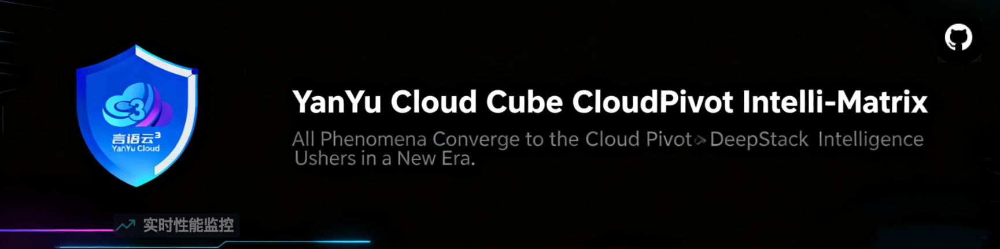

<div align="center">
<a id="top"></a>

# 言语云枢 · YYC3 AI Family HUB 家族智能中枢



### *八魂归一，云枢乃成 | Eight Souls as One, the Hub Complete*

**言语云枢·AI Family 智枢 — 八位 AI 家人的中枢时钟盘、群聊协同、模型管理与家族空间**

> ***YanYuCloudCube***
> *言启象限 | 语枢未来*
> ***Words Initiate Quadrants, Language Serves as Core for Future***
> *万象归元于云枢 | 深栈智启新纪元*
> ***All things converge in cloud pivot; Deep stacks ignite a new era of intelligence***

<br/>

**⭐ GitHub 项目指标 | Repo Metrics**

[](https://github.com/YYC-Cube/YYC3-AI-Family-HUB/stargazers)
[](https://github.com/YYC-Cube/YYC3-AI-Family-HUB/network/members)
[](https://github.com/YYC-Cube/YYC3-AI-Family-HUB/issues)
[](https://github.com/YYC-Cube/YYC3-AI-Family-HUB/commits)

</div>

---

## 项目简介 | About

**YYC3-AI-Family-HUB**（言语云枢·AI Family 智枢）是从 [YYC3-CloudPivot-Matrix-Ops](https://github.com/YYC-Cube/YYC3-CloudPivot-Matrix-Ops) 分离出来的家族智能中枢独立项目：

- **Family中枢（首页 `/`）**：八位 AI 家人（千行 · 万物 · 灵韵 · 先知 · 宗师 · 守护 · 天枢 · 伯乐）的中枢时钟盘，「亦师亦友亦伴乐 · 一言一语一协同」
- **AI Family 导航置首**：Family中枢 / Family首页 / Family中心 / Family模型 / Family设置
- **完整家族空间**：群聊协同、成长档案、活动中心、文娱 / 学习 / 音乐、创作工作室
- **模型管理**：多服务商接入（自定义服务商 / Ollama 本地 / DGX vLLM 反代 / NAS 网关），三步连接测试
- **保留运维底座**：操作中心、文件 / 数据库 / 连接管理、智能引擎（AI 建议 / 诊断 / SDK 对话）、系统管理
- **设备矩阵已移除**：本仓库不含算力矩阵监控 / 巡检 / 告警 / 跟进体系（归母项目）

## 技术栈 | Tech Stack

React 19 · TypeScript 5.9 · Vite 8 · Tailwind CSS 4 · Zustand 5 · Electron 41 · Vitest 4 · PWA

## 快速开始 | Quick Start

```bash
pnpm install          # 安装依赖
pnpm dev              # 开发（Vite 默认端口）
pnpm build            # 生产构建（tsc electron + vite）
pnpm test:ci          # 全量测试
node deploy/server.mjs  # 本地部署服务（默认 0.0.0.0:3119）
```

## 品牌规范 | Brand

品牌单一真源：[`src/app/config/app-brand.ts`](./src/app/config/app-brand.ts)

| 轨 | 值 |
| ---- | ---- |
| 中文主名 | 言语云枢·AI Family 智枢 |
| 英文名 | YYC3 AI Family HUB |
| 技术标识 | `YYC3-AI-Family-HUB` / `yyc3-ai-family-hub` |
| 环境前缀 | `AFH_` |
| Slogan | 八魂归一，云枢乃成（对外）· 亦师亦友亦伴乐，一言一语一协同（对内） |

> 待办：`public/CNAME`（当前沿用母项目 `ops.yyc3.vip`）与 `APP_BRAND.domain` 为分离继承值，新域名确定后两处同步修改（CI 门禁会校验一致性）。

## 许可 | License

MIT © 2026 YanYuCloudCube™（YYC³）· [admin@0379.email](mailto:admin@0379.email)

---

<p align="center">
  <b>YYC³</b>（YanYuCloudCube™ · 注册商标）<br>
  言启象限 | 语枢未来<br>
  <i>Words Initiate Quadrants, Language Serves as Core for Future</i><br>
  万象归元于云枢 | 深栈智启新纪元<br>
  <i>All things converge in cloud pivot; Deep stacks ignite a new era of intelligence</i>
</p>
