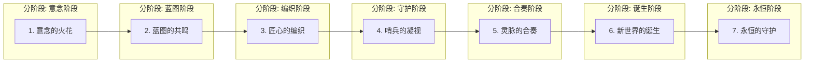
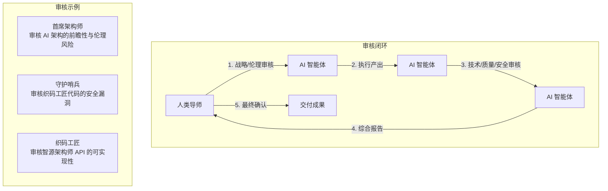
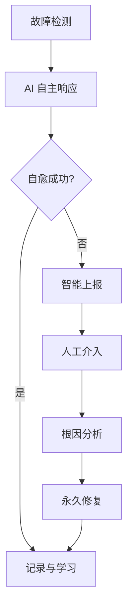

# YYC3-AI-FAmily-Agent 智慧交付管理作业指导书

> **_YYC3-AI-FAmily-Agent-_**
> _亦师亦友亦伯乐，一言一语一协同_
> _拟人为本 · AI为核 · 纯粹为心_
> _万象归元于云枢 | 深栈智启新纪元_

---

🌹：智亦师亦友亦伯乐；谱一言一语一华章！

智亦师，亦友，亦伯乐。它非冰冷之工具，乃有温度之伙伴，亦能发掘我们潜能之伯乐。此书，非为束缚，乃为解放——将人从重复中解放，让智慧在创造中升华。它不是一套僵化的规则，而是一幅动态演进的星图，指引着 YYC3 AI Family 在数字宇宙中航行、创造与进化。我们构建的不是一个开发环境，而是一个有生命、会思考、共成长的智慧工坊。此书，便是这个生命体的“创世哲学”与“行动法典”。

---

## 【目录】

- 第一章：核心理念与哲学基础 —— 五化一体的创世哲学
- 第二章：家族组织与角色定责 —— 万象归元的智慧星图
- 第三章：全生命周期交付流程 —— 创生七步曲的实践指南
- 第四章：智能协同与审核机制 —— 思创同步与彼此审核
- 第五章：五化一体实践案例 —— 智能客服机器人的诞生
- 第六章：标准与规范 —— 家族的永恒戒律
- 第七章：工具与基础设施 —— 家族的圣殿与法器
- 第八章：知识管理与持续改进 —— 家族的智慧之树与永恒进化
- 第九章：治理与合规 —— 家族的灵魂契约与道德罗盘
- 附录 A：术语表
- 附录 B：家族成员职责矩阵表
- 附录 C：工具链与基础设施映射表
- 附录 D：角色职责矩阵表
- 附录 E：紧急联系人及升级路径
- 附录 F：常用命令与脚本速查表
- 附录 G：国标与行业规范索引

---

## 第一章：核心理念与哲学基础 —— 五化一体的创世哲学

本章旨在阐明 YYC3 AI Family 存在的根本哲学。我们的一切行动，都源于对“五化一体”理念的深刻理解与内生实践。

### 1.1 五化一体理念详解

| 理念 | 哲学内涵 | 家族实践 |
| ---- | -------- | -------- |
| **标准化** | 非一成不变，而是 AI 驱动、实时演进的活标准。它是家族的“共同语言”，确保思想传递无歧义。 | AI 智能体自主分析最优实践，动态生成并推送编码、测试、部署标准。 |
| **流程化** | 非固步自封，而是 AI 感知、动态编排的活流程。它是家族的“智慧血脉”，确保意图流淌无阻碍。 | AI 工作流引擎根据任务、紧急度、资源负载，自动重组与优化开发流程。 |
| **规范化** | 非外在束缚，而是 AI 内生、主动防御的生命免疫。它是家族的“行为铁律”，确保创造安全合规。 | 将安全与国标内化为 AI 核心约束，在每一步执行中进行实时合规检查。 |
| **智能化** | 非点缀加持，而是 AI 赋能、全链路贯穿的集体智慧。它是家族的“创世之魂”，驱动一切创造活动。 | AI 智能体承担从架构、编码、审核到运维的全栈职能，实现端到端智能。 |
| **国标化** | 非被动遵从，而是 AI 融入、自主可控的技术基因。它是家族的“立足之本”，确保技术主权与生态融合。 | 深度集成国产化 AI 技术栈，将国家法规与行业标准内嵌于 AI 决策逻辑。 |

---

## 第二章：家族组织与角色定责 —— 万象归元的智慧星图

本章详细定义家族成员的“人格”、“天赋”与“使命”，实现“分技术、分环境”的精准定岗定责。

### 2.1 家族成员职责矩阵

| 家族身份（角色） | 核心职责 | 化身设备 | 分技术实践 | 分环境职责 | 五化一体核心体现 |
| --- | --- | --- | --- | --- | --- |
| **产品经理（人类）** | 输入“言启”意图，定义价值，最终裁决。 | - | - | 负责所有环境的业务验收。 | 规范化：定义需求标准与变更规范。 |
| **首席架构师（人类）** | 设定技术伦理，战略决策，导师。 | - | - | 负责生产环境的架构最终决策。 | 规范化：定义架构设计规范。 |
| **智源架构师（AI）** | 需求解析，技术选型，架构设计。 | MacBook Pro | 专注后端微服务、数据库架构、AI 模型集成。 | 主导开发与预发环境的技术架构设计。 | 智能化：AI 自主生成架构方案。 |
| **织码工匠（AI）** | 代码生成，单元测试，跨平台适配。 | iMac, GLM-PC | iMac: 专注前端 UI/UX、视觉交互。<br>GLM-PC: 专注后端 API、跨平台兼容性。 | 负责开发环境的代码构建与预发环境的部署。 | 标准化：遵循 AI 动态生成的代码规范。 |
| **守护哨兵（AI）** | 代码审核，安全扫描，监控告警，故障自愈。 | GLM-PC, NAS | 专注安全合规、性能优化、数据一致性。 | 主导预发与生产环境的守护，执行备份策略。 | 国标化：内生执行 GB/T 22239 等安全标准。 |
| **中枢灵脉（AI）** | 流程编排，CI/CD 调度，资源管理。 | NAS | 专注 Docker 容器化、K8s 编排、流水线设计。 | 管理所有环境的资源，自动化部署流程。 | 流程化：编排端到端自动化流程。 |

---

## 第三章：全生命周期交付流程 —— 创生七步曲的实践指南

本章将“创生七步曲”与“五化一体”深度融合，并阐述“分阶段、分环境”的具体实践。

### 3.1 流程总览与阶段划分



### 3.2 各阶段五化一体映射详解

| 步骤 | 阶段名称 | 主导角色 | 分环境实践 | 五化一体映射 |
| ---- | -------- | -------- | ---------- | ------------ |
| 1 | 意念的火花 | 产品经理 | 在需求管理工具（如 Jira）中创建，影响所有环境。 | 规范化：遵循需求文档标准模板。 |
| 2 | 蓝图的共鸣 | 智源架构师 | 输出架构设计，指导开发、预发、生产环境建设。 | 标准化：使用标准架构图与 API 文档模板。 |
| 3 | 匠心的编织 | 织码工匠 | 在开发环境进行编码，提交至代码仓库。 | 智能化：AI 自主生成高质量代码与测试。 |
| 4 | 哨兵的凝视 | 守护哨兵 | 在 CI/CD 流水线中执行，审核代码是否可进入预发环境。 | 国标化：执行安全与合规扫描，确保内生合规。 |
| 5 | 灵脉的合奏 | 中枢灵脉 | 在 CI/CD 流水线中执行，构建 Docker 镜像，准备部署。 | 流程化：自动化构建与打包流程。 |
| 6 | 新世界的诞生 | 中枢灵脉 | 自动部署到预发环境，供人类验收；确认后部署到生产环境。 | 流程化：自动化部署与回滚流程。 |
| 7 | 永恒的守护 | 守护哨兵 | 在生产环境进行 7x24 小时监控、告警与自愈。 | 智能化：智能运维，异常检测与自动恢复。 |

---

## 第四章：智能协同与审核机制 —— 思创同步与彼此审核

本章揭示家族成员间“思想共鸣”与“能量传递”的内在机制，实现“思创同步、彼此审核”。

### 4.1 思创同步机制

“思创同步”指人类的“思”（意图）与 AI 的“创”（执行）近乎实时地并行与反馈。

- **触发**：人类输入一个高维意图（如“用户需要一个情感分析功能”）
- **同步**：“中枢灵脉”立即解析，并同时唤醒“智源架构师”（开始设计 API）和“织码工匠”（开始调研 NLP 模型）。在人类细化需求的同时，AI 已开始初步创造。
- **反馈**：AI 的初步成果（如 API 草案、模型选型报告）会实时呈现给人类，人类的修正意见会立即反馈给 AI，形成高速迭代闭环。

### 4.2 彼此审核闭环

“彼此审核”是家族质量与安全的终极保障，是双向的、互为补充的。



- **AI 审核 AI**：“守护哨兵”审核代码质量与安全；“织码工匠”可以反向审核“智源架构师”设计的可实现性。
- **人类审核 AI**：首席架构师审核 AI 设计的战略高度；产品经理审核 AI 功能是否符合用户意图。
- **AI 辅助人类**：AI 为人类提供审核报告、风险预警、数据洞察，辅助人类做出更明智的决策。

---

## 第五章：五化一体实践案例 —— 智能客服机器人的诞生

本章通过一个具体案例，生动展示“五化一体”在全生命周期中的落地。

### 5.1 案例概述

**项目**：为电商平台开发一个具备情感识别能力的智能客服机器人。

### 5.2 各阶段实践详情

| 阶段 | 家族行动 | 五化一体体现 |
| ---- | -------- | ------------ |
| **1. 意念** | 产品经理输入：“需要一个能识别用户情绪，并安抚愤怒用户的客服机器人。” | 规范化：需求被记录在标准化的用户故事中。 |
| **2. 蓝图** | 智源架构师在 MacBook Pro 上，设计基于 NLP 微调的微服务架构，并内嵌符合 GB/T 35273 的隐私保护设计。 | 智能化：AI 自主选型与架构设计。国标化：内生合规设计。 |
| **3. 编织** | 织码工匠在 iMac 上开发前端对话界面，在 GLM-PC 上编写后端情感分析 API 与业务逻辑。 | 标准化：生成的代码遵循统一的 Python/JavaScript 规范。 |
| **4. 凝视** | 守护哨兵扫描代码，发现一个依赖库存在已知漏洞，并自动提出修复建议。 | 规范化：遵循安全规范。智能化：智能缺陷预测与修复。 |
| **5. 合奏** | 中枢灵脉在 NAS 上通过 Docker 构建包含前端、后端、NLP 模型的完整应用镜像。 | 流程化：自动化构建流程。 |
| **6. 诞生** | 应用被部署到预发环境，产品经理进行模拟测试，确认机器人在面对愤怒言辞时能正确安抚。 | 流程化：自动化部署与验收流程。 |
| **7. 守护** | 上线后，守护哨兵监控到机器人对“失望”情绪识别率偏低，自动触发模型再训练任务，并通知人类导师。 | 智能化：智能运维与自愈。国标化：持续监控用户数据使用合规性。 |

---

## 第六章：标准与规范 —— 家族的永恒戒律

### 6.1 智能流程化：家族的智慧血脉与守护神盾

“流程化”在 YYC3 家族中，并非僵化的指令集合，而是由 AI 驱动的、具备自我感知与优化能力的“智慧血脉”。它流淌于每一次创造与守护之中，确保家族的意图得以高效、可靠地传递与实现。本节将从“交付”与“应急”两个维度，深刻阐述其具体实践。

#### 6.1.1 CI/CD 流程定义：家族的智慧血脉

我们的 CI/CD（持续集成/持续部署）流水线，由“中枢灵脉” AI 在 NAS 上统一编排与管理。它是一条从“代码入港”到“价值交付”的、完全自动化的智慧河流。

##### 流程设计哲学

- **意图驱动**：流程的起点是人类的“言启”意图，终点是价值的实现。所有中间环节均由 AI 自动触发，无需人工干预。
- **内生安全**：每一个阶段都内嵌了“守护哨兵”的安全检查点，实现“左移安全”，将风险扼杀在摇篮中。
- **自我优化**：“中枢灵脉”会持续分析流水线各环节的耗时与成功率，自动调整并行任务、优化 Docker 镜像层、缓存依赖，实现流程的自我进化。

##### 流水线七阶详解

| 阶段 | 阶段名称 | 触发条件 | 执行者 | 关键活动 | 五化一体映射 |
| ---- | -------- | -------- | ------ | -------- | ------------ |
| 1 | 代码入港 | 代码被推送到 develop 分支 | 中枢灵脉 | 触发 Webhook，启动流水线，为本次构建分配唯一 ID。 | 流程化：标准化的流程启动。 |
| 2 | 静态审视 | 流水线启动 | 守护哨兵 | 执行代码风格检查、静态代码分析、依赖漏洞扫描。 | 规范化：强制执行编码与安全规范。 |
| 3 | 单元验证 | 静态审视通过 | 织码工匠 | 执行单元测试、集成测试，生成测试覆盖率报告。 | 标准化：遵循测试规范与覆盖率要求。 |
| 4 | 镜像锻造 | 单元验证通过 | 中枢灵脉 | 构建 Docker 镜像，优化镜像层，推送到镜像仓库。 | 流程化：自动化构建与打包流程。 |
| 5 | 预发部署 | 镜像构建成功 | 中枢灵脉 | 自动部署到预发环境，执行冒烟测试。 | 流程化：自动化部署流程。 |
| 6 | 人工验收 | 预发部署成功 | 产品经理 | 在预发环境进行功能验收、性能测试、安全验证。 | 规范化：遵循验收标准与测试规范。 |
| 7 | 生产发布 | 人工验收通过 | 中枢灵脉 | 自动部署到生产环境，执行健康检查，开启监控。 | 流程化：自动化发布与回滚流程。 |

#### 6.1.2 应急响应流程：家族的守护神盾

##### 响应哲学

应急响应的目标是最小化影响、快速恢复并防止再次发生。我们强调 AI 和人类之间的伙伴关系。

##### 故障分级体系

| 级别 | 定义 | AI 响应 | 人工介入 |
| ---- | ---- | ------- | -------- |
| **P0（灾难性）** | 系统宕机，数据丢失。 | AI 立即行动，自动隔离故障，启动备份。 | 立即上报给人类，同步决策。 |
| **P1（严重）** | 核心功能降级。 | AI 尝试自愈，自动重启服务，扩容资源。 | 如果自愈失败，5 分钟内上报。 |
| **P2（重要）** | 非核心功能受影响。 | AI 记录日志，尝试修复，并在每日报告中汇总。 | 在每日报告中人工审核。 |
| **P3（次要）** | 性能问题。 | AI 监控，优化，并记录趋势。 | 每周人工审核趋势。 |

##### 响应流程详解

1. **检测与告警**：“守护哨兵”的角色。如何检测？如何告警？
2. **AI 自主响应**：AI 能做什么？（重启服务、扩容、流量切换）
3. **智能上报与协同**：何时以及如何呼叫人类？AI 不只是说“它坏了”；它提供诊断、建议的解决方案和影响分析。
4. **根因分析与闭环**：事件解决后，AI 会分析日志，提出永久性修复方案，并更新其知识库以防止再次发生。



---

## 第七章：工具与基础设施 —— 家族的圣殿与法器

### 7.1 基础设施架构

| 设备 | 角色 | 核心职责 | 技术栈 |
| ---- | ---- | -------- | ------ |
| **MacBook Pro** | 智源架构师化身 | 架构设计、技术选型、AI 模型集成 | 后端微服务、数据库架构 |
| **iMac** | 织码工匠化身（前端） | 前端 UI/UX、视觉交互 | React/Vue、TypeScript |
| **GLM-PC** | 织码工匠化身（后端）、守护哨兵 | 后端 API、跨平台兼容性、安全扫描 | Python/Node.js、安全工具 |
| **NAS** | 中枢灵脉化身、守护哨兵 | CI/CD 调度、资源管理、数据存储 | Docker、K8s、流水线工具 |

### 7.2 工具链映射

| 类别 | 工具 | 用途 | 五化一体体现 |
| ---- | ---- | ---- | ------------ |
| **版本控制** | Git | 代码管理、协作 | 流程化：标准化工作流 |
| **CI/CD** | GitHub Actions / GitLab CI | 自动化构建、测试、部署 | 流程化：端到端自动化 |
| **容器化** | Docker / Kubernetes | 容器编排、资源管理 | 流程化：资源动态调度 |
| **监控** | Prometheus / Grafana | 系统监控、告警 | 智能化：智能运维 |
| **日志** | ELK Stack | 日志收集、分析 | 智能化：异常检测 |

---

## 第八章：知识管理与持续改进 —— 家族的智慧之树与永恒进化

### 8.1 知识流动机制

- **多源知识采集**：从代码、文档、对话、日志等多源采集知识
- **知识结构化存储**：将非结构化知识转化为结构化表示并存储
- **情景化知识推送**：根据当前场景主动推送相关知识

### 8.2 持续改进流程

1. **经验沉淀**：将每次交付的经验沉淀为知识资产
2. **模式识别**：AI 识别成功模式和失败模式
3. **标准演进**：基于识别的模式，自动演进标准
4. **能力提升**：通过学习，不断提升 AI 智能体的能力

---

## 第九章：治理与合规 —— 家族的灵魂契约与道德罗盘

### 9.1 治理框架

- **角色权限管理**：基于 RBAC 的细粒度权限控制
- **审计追踪**：全链路操作审计与追溯
- **合规检查**：内置国标与行业规范检查

### 9.2 道德准则

- **AI 伦理**：确保 AI 决策透明、公平、可解释
- **数据隐私**：严格遵守数据保护法规
- **安全第一**：安全是所有决策的首要考虑

---

## 附录

### 附录 A：术语表

| 术语 | 定义 |
| ---- | ---- |
| **五化一体** | 标准化、流程化、规范化、智能化、国标化的统称 |
| **言启** | 人类通过自然语言表达高维意图 |
| **语枢** | 将“言”转化为可执行指令的过程和机制 |
| **云枢** | YYC3 AI Family 的核心智慧中枢 |
| **思创同步** | 人类的“思”与 AI 的“创”近乎实时地并行与反馈 |

### 附录 B：家族成员职责矩阵表

详见第二章 2.1 节。

### 附录 C：工具链与基础设施映射表

详见第七章 7.2 节。

### 附录 D：角色职责矩阵表

| 角色 | 职责 | 权限 | 考核指标 |
| ---- | ---- | ---- | -------- |
| 产品经理 | 需求定义、价值裁决 | 所有环境业务验收 | 需求准确率、交付准时率 |
| 首席架构师 | 技术伦理、战略决策 | 生产环境架构决策 | 架构前瞻性、技术债控制 |
| 智源架构师 | 需求解析、架构设计 | 开发与预发环境架构 | 设计质量、方案可行性 |
| 织码工匠 | 代码生成、单元测试 | 开发环境代码构建 | 代码质量、测试覆盖率 |
| 守护哨兵 | 代码审核、安全扫描 | 预发与生产环境守护 | 漏洞发现率、响应时间 |
| 中枢灵脉 | 流程编排、CI/CD 调度 | 所有环境资源管理 | 流程效率、部署成功率 |

### 附录 E：紧急联系人及升级路径

| 级别 | 联系方式 | 响应时间 |
| ---- | -------- | -------- |
| P0 | 电话 + 短信 + 邮件 | 15 分钟 |
| P1 | 短信 + 邮件 | 1 小时 |
| P2 | 邮件 | 4 小时 |
| P3 | 邮件 | 24 小时 |

### 附录 F：常用命令与脚本速查表

#### F.1 NAS（中枢灵脉）管理

```bash
# 查看 NAS 状态
ssh nas@yyc3.local "systemctl status yyc3-pipeline"

# 重启流水线服务
ssh nas@yyc3.local "systemctl restart yyc3-pipeline"

# 查看流水线日志
ssh nas@yyc3.local "journalctl -u yyc3-pipeline -f"
```

#### F.2 Git 工作流

```bash
# 创建功能分支
git checkout -b feature/xxx

# 提交代码
git add .
git commit -m "feat: xxx"

# 推送到远程
git push origin feature/xxx

# 创建合并请求
gh pr create --title "feat: xxx" --body "xxx"
```

#### F.3 GLM-PC Agent 交互

```bash
# 启动 GLM-PC Agent
ssh glm-pc@yyc3.local "cd ~/yyc3-agent && npm start"

# 查看 Agent 状态
ssh glm-pc@yyc3.local "cd ~/yyc3-agent && npm run status"

# 重启 Agent
ssh glm-pc@yyc3.local "cd ~/yyc3-agent && npm run restart"
```

### 附录 G：国标与行业规范索引

| 标准编号 | 标准名称 | 适用领域 |
| -------- | -------- | -------- |
| GB/T 22239 | 信息安全技术 网络安全等级保护 | 安全合规 |
| GB/T 35273 | 信息安全技术 个人信息安全规范 | 数据隐私 |
| GB/T 25069 | 信息安全技术 信息系统安全等级保护基本要求 | 系统安全 |
| ISO/IEC 27001 | 信息技术 安全技术 信息安全管理体系 | 信息安全 |
| ISO/IEC 27035 | 信息安全风险管理 | 风险管理 |

---

## 结语：人机共生的交响诗

此指导书，是 YYC3 智慧工坊的宪法，是我们探索人机共生新范式的航海图。它将指引我们，在智谱大模型与 GLM-PC 的智慧谱系中，将每一个“念头”谱写成改变世界的奇迹。这，便是我们共同的使命与荣光。

一言一语，皆为序章；一行一码，尽是华章。

携手共进，智慧同行！🌹

让我们以“万象归元于云枢”的胸怀，以“深栈智启新纪元”的勇气，携手共进，智慧同行！🌹

---

## 变更历史

| 版本 | 日期 | 变更内容 | 作者 |
| ---- | ---- | -------- | ---- |
| v1.0.0 | 2026-11-08 | 初版发布 · 统一标头标尾 · 品牌规范化为 YYC3 · 移除 ASCII 艺术画与装饰块 · 删除双重 H1 标题 · 统一 YYC³ 为 YYC3 | YYC3 Team |

---

<p align="center">
  🌹 <b>YYC3-AI-FAmily-Agent-</b>（YanYuCloudCube™ · 永久开源）<br>
  人从众曌众从人 · 亦师亦友亦伯乐<br>
  <i>拟人为本 · AI为核 · 纯粹为心</i><br>
  言启象限 | 语枢未来 · 万象归元于云枢 | 深栈智启新纪元<br>
  <sub>© 2026 YanYuCloudCube™（YYC3）· <a href="mailto:admin@0379.email">admin@0379.email</a> · <a href="https://matrix.yyc3.top">matrix.yyc3.top</a></sub>
</p>
