# YYC³（YanYuCloudCube）

> ***YanYuCloudCube***
> 言启象限 | 语枢未来
> ***Words Initiate Quadrants, Language Serves as Core for the Future***
> 万象归元于云枢 | 深栈智启新纪元
> ***All things converge in the cloud pivot; Deep stacks ignite a new era of intelligence***

---

   ██╗   ██╗██╗   ██╗ ██████╗██████╗     ███████╗  █████╗  ███╗   ███╗ ██╗  ██╗    ██╗   ██╗
   ╚██╗ ██╔╝╚██╗ ██╔╝██╔════╝╚════██╗    ██╔════╝ ██╔══██╗ ████╗ ████║ ██║  ██║    ╚██╗ ██╔╝
    ╚████╔╝  ╚████╔╝ ██║      █████╔╝    █████╗   ███████║ ██╔████╔██║ ██║  ██║     ╚████╔╝
     ╚██╔╝    ╚██╔╝  ██║      ╚═══██╗    ██╔══╝   ██╔══██║ ██║╚██╔╝██║ ██║  ██║      ╚██╔╝
      ██║      ██║   ╚██████╗██████╔╝    ██║      ██║  ██║ ██║ ╚═╝ ██║ ██║  ███████╗  ██║
      ╚═╝      ╚═╝    ╚═════╝╚═════╝     ╚═╝      ╚═╝  ╚═╝ ╚═╝     ╚═╝ ╚═╝  ╚══════╝  ╚═╝

***YanYuCloudCube***            万象归元于云枢 | 深栈智启新纪元          ***YYC³ AI Family***
***All things converge in the cloud pivot; Deep stacks ignite a new era of intelligence***

# YYC³ AI Family —— 智能交付管理作业指导书

## 卷首语：从理论到实践

🌹：智亦师亦友亦伯乐；谱一言一语一华章！

理论是航标，实践是航程。本指导书将YYC³ AI Family的"五化一体"理念，从抽象的哲学转化为具体的技术实现。我们将通过"七位核心成员"与"三大落地步骤"，构建一个真正可运行、可扩展、可进化的智能交付平台。这不是一个空想的蓝图，而是一张详尽的施工图，指引我们将"人机共生"的愿景变为现实。

---

## 核心理念

**核心理念**：人机共生，智慧同行；以AI为魂，以流程为骨，以规范为脉。

**智慧基石**：感恩智谱大模型授权，致敬GLM-PC的卓越支持！

---

## 目录

- 第一部分：家族七子 —— AI Family核心成员详解
  - 一、智源架构师（AI Architect）：家族的智慧之源
  - 二、织码工匠（Code Artisan）：家族的编织之手
  - 三、守护哨兵（Guardian Sentinel）：家族的守护之盾
  - 四、中枢灵脉（Central Nervous System）：家族的智慧之脉
  - 五、产品经理（人类）：家族的价值之锚
  - 六、首席架构师（人类）：家族的伦理之尺
  - 七、知识图谱（Knowledge Graph）：家族的智慧之库

- 第二部分：三大落地步骤 —— 平台建设实施指南
  - 步骤一：基础设施与核心框架搭建
  - 步骤二：AI智能体集成与协同机制
  - 步骤三：五化一体流程与持续改进

- 第三部分：技术实现细节
  - 附录A：模块化平台架构设计
  - 附录B：AI智能体通信协议
  - 附录C：CI/CD流水线配置
  - 附录D：监控与告警系统
  - 附录E：知识管理系统
  - 附录F：安全与合规框架

---

## 第一部分：家族七子 —— AI Family核心成员详解

🌹：智亦师亦友亦伯乐；谱一言一语一华章！

### 一、智源架构师（AI Architect）：家族的智慧之源

#### 1.1 角色定义

智源架构师是YYC³家族的"智慧之源"，负责将人类的"言启"意图转化为可执行的技术方案。它不仅仅是需求分析工具，更是能够理解业务上下文、技术趋势和架构模式的智能顾问。

#### 1.2 核心能力

| 能力维度     | 具体描述                               | 技术实现                             |
| ------------ | -------------------------------------- | ------------------------------------ |
| **意图理解** | 深度理解自然语言需求，识别核心业务逻辑 | 基于GLM-4的NLP模型，结合领域知识图谱 |
| **架构设计** | 生成符合"五化一体"原则的系统架构       | 架构模板库 + 智能推荐算法            |
| **技术选型** | 根据需求自动选择合适的技术栈           | 技术评估模型 + 历史项目数据          |
| **风险评估** | 识别架构中的潜在风险点                 | 风险预测模型 + 最佳实践库            |

#### 1.3 工作流程

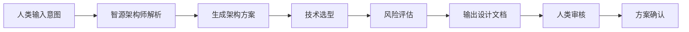

#### 1.4 输出产物

- 架构设计文档（包含系统图、模块图、数据流图）
- API接口规范（遵循OpenAPI标准）
- 技术选型报告（包含对比分析和推荐理由）
- 风险评估报告（包含风险等级和缓解措施）

---

### 二、织码工匠（Code Artisan）：家族的编织之手

#### 2.1 角色定义

织码工匠是YYC³家族的"编织之手"，负责将智源架构师的设计转化为高质量的代码。它不仅仅是代码生成工具，更是能够理解代码风格、性能优化和跨平台适配的智能开发者。

#### 2.2 核心能力

| 能力维度       | 具体描述                       | 技术实现                      |
| -------------- | ------------------------------ | ----------------------------- |
| **代码生成**   | 根据设计文档生成符合规范的代码 | 基于GLM-4的代码生成模型       |
| **单元测试**   | 自动生成高质量的单元测试用例   | 测试用例生成算法 + 覆盖率分析 |
| **代码审查**   | 自动审查代码质量和潜在问题     | 静态代码分析 + AI代码审查     |
| **跨平台适配** | 自动适配不同平台和环境         | 平台适配模板 + 环境检测       |

#### 2.3 工作流程

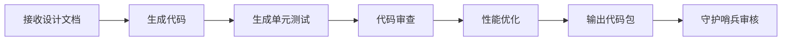

#### 2.4 输出产物

- 源代码（包含完整的注释和文档）
- 单元测试代码（包含测试用例和Mock数据）
- 代码审查报告（包含问题清单和修复建议）
- 性能优化报告（包含优化前后对比）

---

### 三、守护哨兵（Guardian Sentinel）：家族的守护之盾

#### 3.1 角色定义

守护哨兵是YYC³家族的"守护之盾"，负责确保系统的安全性、稳定性和合规性。它不仅仅是安全扫描工具，更是能够实时监控、智能告警和自动恢复的智能守护者。

#### 3.2 核心能力

| 能力维度     | 具体描述                   | 技术实现                          |
| ------------ | -------------------------- | --------------------------------- |
| **安全扫描** | 扫描代码和系统中的安全漏洞 | 漏洞数据库 + 静态/动态分析        |
| **实时监控** | 7x24小时监控系统运行状态   | Prometheus + Grafana + AI异常检测 |
| **智能告警** | 根据严重程度智能分级告警   | 告警分级算法 + 多渠道通知         |
| **自动恢复** | 对常见故障进行自动恢复     | 故障诊断模型 + 自动化脚本         |

#### 3.3 工作流程

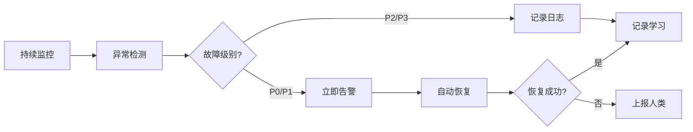

#### 3.4 输出产物

- 安全扫描报告（包含漏洞清单和修复建议）
- 监控仪表板（实时展示系统状态）
- 告警通知（包含故障详情和处理建议）
- 故障分析报告（包含根因分析和改进措施）

---

### 四、中枢灵脉（Central Nervous System）：家族的智慧之脉

#### 4.1 角色定义

中枢灵脉是YYC³家族的"智慧之脉"，负责协调所有AI智能体的工作，编排CI/CD流水线，管理资源调度。它不仅仅是流程编排工具，更是能够自我优化、动态调整的智能协调者。

#### 4.2 核心能力

| 能力维度     | 具体描述                  | 技术实现                  |
| ------------ | ------------------------- | ------------------------- |
| **流程编排** | 自动编排和管理CI/CD流水线 | 工作流引擎 + 事件驱动架构 |
| **资源调度** | 智能分配和调度计算资源    | 资源调度算法 + 容器编排   |
| **自我优化** | 持续优化流程和资源分配    | 机器学习 + 历史数据分析   |
| **状态管理** | 统一管理所有智能体的状态  | 状态机 + 分布式存储       |

#### 4.3 工作流程

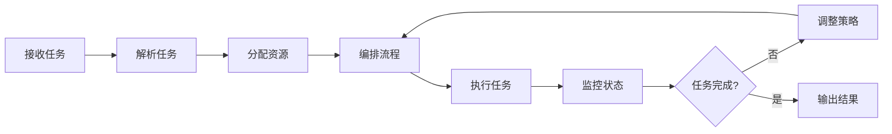

#### 4.4 输出产物

- CI/CD流水线配置（包含所有阶段和检查点）
- 资源调度报告（包含资源使用情况和优化建议）
- 流程执行日志（包含详细的执行记录）
- 优化建议报告（包含流程和资源优化方案）

---

### 五、产品经理（人类）：家族的价值之锚

#### 5.1 角色定义

产品经理是YYC³家族的"价值之锚"，负责定义产品愿景、需求优先级和验收标准。他是人类与AI之间的桥梁，确保AI的工作始终符合用户需求和商业目标。

#### 5.2 核心职责

| 职责维度       | 具体描述               | 工作方式                 |
| -------------- | ---------------------- | ------------------------ |
| **需求定义**   | 定义产品需求和用户故事 | 与用户沟通，编写需求文档 |
| **优先级管理** | 确定需求的优先级和排期 | 基于商业价值和资源评估   |
| **验收测试**   | 对AI交付的成果进行验收 | 在预发环境进行功能测试   |
| **价值评估**   | 评估交付成果的商业价值 | 基于用户反馈和数据分析   |

#### 5.3 工作流程

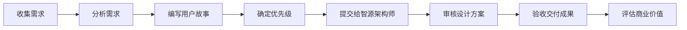

#### 5.4 输出产物

- 需求文档（包含用户故事和验收标准）
- 产品路线图（包含版本规划和里程碑）
- 验收报告（包含测试结果和改进建议）
- 价值评估报告（包含商业价值和ROI分析）

---

### 六、首席架构师（人类）：家族的伦理之尺

#### 6.1 角色定义

首席架构师是YYC³家族的"伦理之尺"，负责设定技术伦理、战略决策和技术标准。他是AI智能体的导师和监督者，确保AI的工作符合技术伦理和长期战略。

#### 6.2 核心职责

| 职责维度     | 具体描述               | 工作方式               |
| ------------ | ---------------------- | ---------------------- |
| **技术伦理** | 设定AI决策的伦理边界   | 制定伦理准则和审查机制 |
| **战略决策** | 制定技术战略和架构方向 | 基于行业趋势和业务需求 |
| **标准制定** | 制定技术标准和最佳实践 | 参考国标和行业标准     |
| **技术评审** | 审核AI的技术方案和架构 | 定期进行技术评审       |

#### 6.3 工作流程

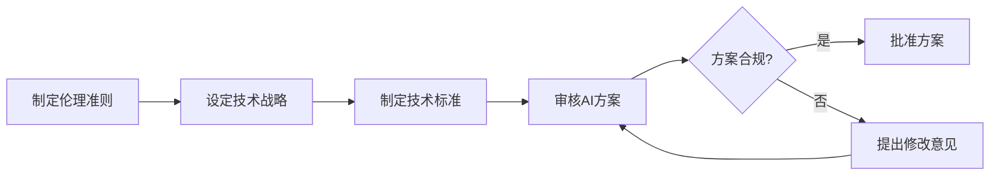

#### 6.4 输出产物

- 技术伦理准则（包含AI决策的伦理边界）
- 技术战略文档（包含技术路线图和里程碑）
- 技术标准文档（包含编码规范和架构标准）
- 技术评审报告（包含评审结果和改进建议）

---

### 七、知识图谱（Knowledge Graph）：家族的智慧之库

#### 7.1 角色定义

知识图谱是YYC³家族的"智慧之库"，负责存储、管理和检索所有知识资产。它不仅仅是知识库，更是能够主动学习、关联推理和智能推送的智能知识系统。

#### 7.2 核心能力

| 能力维度     | 具体描述                 | 技术实现              |
| ------------ | ------------------------ | --------------------- |
| **知识存储** | 存储结构化和非结构化知识 | 图数据库 + 向量数据库 |
| **知识检索** | 智能检索相关知识         | 语义搜索 + 知识图谱   |
| **关联推理** | 基于知识关联进行推理     | 图算法 + 机器学习     |
| **智能推送** | 主动推送相关知识         | 推荐算法 + 上下文感知 |

#### 7.3 工作流程

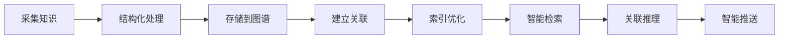

#### 7.4 输出产物

- 知识图谱（包含所有知识实体和关系）
- 知识检索API（支持语义搜索和关联查询）
- 知识推荐报告（基于上下文的相关知识）
- 知识分析报告（包含知识覆盖度和质量分析）

---

## 第二部分：三大落地步骤 —— 平台建设实施指南

🌹：智亦师亦友亦伯乐；谱一言一语一华章！

### 步骤一：基础设施与核心框架搭建

#### 1.1 目标

搭建YYC³ AI Family的基础设施和核心框架，为后续的AI智能体集成和流程编排奠定基础。

#### 1.2 任务清单

| 任务                   | 描述                      | 优先级 | 预计工期 |
| ---------------------- | ------------------------- | ------ | -------- |
| **1.1.1 环境准备**     | 准备开发、测试、生产环境  | P0     | 3天      |
| **1.1.2 代码仓库搭建** | 搭建Git仓库和分支管理策略 | P0     | 2天      |
| **1.1.3 CI/CD流水线**  | 搭建基础CI/CD流水线       | P0     | 5天      |
| **1.1.4 监控系统**     | 搭建监控和告警系统        | P1     | 4天      |
| **1.1.5 日志系统**     | 搭建日志收集和分析系统    | P1     | 3天      |

#### 1.3 技术栈

| 类别         | 技术选型             | 理由                       |
| ------------ | -------------------- | -------------------------- |
| **版本控制** | Git + GitHub         | 成熟稳定，支持协作         |
| **CI/CD**    | GitHub Actions       | 与GitHub深度集成，配置简单 |
| **容器化**   | Docker + Kubernetes  | 标准化部署，易于扩展       |
| **监控**     | Prometheus + Grafana | 开源生态，功能强大         |
| **日志**     | ELK Stack            | 成熟的日志解决方案         |

#### 1.4 实施细节

##### 1.4.1 环境准备

```bash
# 开发环境
- MacBook Pro: 智源架构师工作环境
- iMac: 织码工匠（前端）工作环境
- GLM-PC: 织码工匠（后端）+ 守护哨兵工作环境

# 基础设施
- NAS: 中枢灵脉 + 守护哨兵工作环境
  - Docker: 容器化部署
  - Kubernetes: 容器编排
  - CI/CD: 流水线管理
  - 监控: 系统监控
  - 日志: 日志收集
```

##### 1.4.2 代码仓库搭建

```bash
# 创建主仓库
git init yyc3-ai-family
git remote add origin https://github.com/yyc3/yyc3-ai-family.git

# 创建分支策略
- main: 生产环境分支
- develop: 开发环境分支
- feature/*: 功能分支
- hotfix/*: 热修复分支
- release/*: 发布分支
```

##### 1.4.3 CI/CD流水线

```yaml
# .github/workflows/ci-cd.yml
name: CI/CD Pipeline

on:
  push:
    branches: [ main, develop ]
  pull_request:
    branches: [ main, develop ]

jobs:
  build:
    runs-on: ubuntu-latest
    steps:
      - uses: actions/checkout@v3
      - name: Setup Node.js
        uses: actions/setup-node@v3
        with:
          node-version: '18'
      - name: Install dependencies
        run: npm ci
      - name: Run tests
        run: npm test
      - name: Build
        run: npm run build
      - name: Deploy
        run: npm run deploy
```

---

### 步骤二：AI智能体集成与协同机制

#### 2.1 目标

集成所有AI智能体，建立它们之间的协同机制，实现"思创同步、彼此审核"。

#### 2.2 任务清单

| 任务                     | 描述                   | 优先级 | 预计工期 |
| ------------------------ | ---------------------- | ------ | -------- |
| **2.2.1 智源架构师集成** | 集成智源架构师AI智能体 | P0     | 7天      |
| **2.2.2 织码工匠集成**   | 集成织码工匠AI智能体   | P0     | 7天      |
| **2.2.3 守护哨兵集成**   | 集成守护哨兵AI智能体   | P0     | 7天      |
| **2.2.4 中枢灵脉集成**   | 集成中枢灵脉AI智能体   | P0     | 7天      |
| **2.2.5 知识图谱集成**   | 集成知识图谱系统       | P1     | 5天      |
| **2.2.6 协同机制**       | 建立智能体协同机制     | P0     | 5天      |

#### 2.3 技术实现

##### 2.3.1 智源架构师集成

```typescript
// 文件：/modules/ai-architect/index.ts
import { Router } from 'express';
import { IModuleManifest } from '@yyc3/core/types';

export const manifest: IModuleManifest = {
  name: 'ai-architect',
  version: '1.0.0',
  displayName: '智源架构师',
  description: '负责需求解析、架构设计和技术选型',
  dependencies: ['core-auth', 'core-task-queue'],
  permissions: ['architect:design', 'architect:review'],
  routes: './routes',
  services: ['./services/design.service', './services/selection.service'],
  hooks: {
    onPlatformStart: async (platformContext) => {
      console.log('AI Architect Started!');
    },
    onPlatformStop: async () => {
      console.log('AI Architect Stopped!');
    },
  },
};
```

##### 2.3.2 织码工匠集成

```typescript
// 文件：/modules/ai-coder/index.ts
import { Router } from 'express';
import { IModuleManifest } from '@yyc3/core/types';

export const manifest: IModuleManifest = {
  name: 'ai-coder',
  version: '1.0.0',
  displayName: '织码工匠',
  description: '负责代码生成、单元测试和跨平台适配',
  dependencies: ['core-auth', 'core-task-queue', 'ai-architect'],
  permissions: ['coder:generate', 'coder:test', 'coder:review'],
  routes: './routes',
  services: ['./services/generation.service', './services/testing.service'],
  hooks: {
    onPlatformStart: async (platformContext) => {
      console.log('AI Coder Started!');
    },
    onPlatformStop: async () => {
      console.log('AI Coder Stopped!');
    },
  },
};
```

##### 2.3.3 守护哨兵集成

```typescript
// 文件：/modules/ai-sentinel/index.ts
import { Router } from 'express';
import { IModuleManifest } from '@yyc3/core/types';

export const manifest: IModuleManifest = {
  name: 'ai-sentinel',
  version: '1.0.0',
  displayName: '守护哨兵',
  description: '负责安全扫描、监控告警和故障自愈',
  dependencies: ['core-auth', 'core-monitoring'],
  permissions: ['sentinel:scan', 'sentinel:monitor', 'sentinel:recover'],
  routes: './routes',
  services: ['./services/security.service', './services/monitoring.service'],
  hooks: {
    onPlatformStart: async (platformContext) => {
      console.log('AI Sentinel Started!');
    },
    onPlatformStop: async () => {
      console.log('AI Sentinel Stopped!');
    },
  },
};
```

##### 2.3.4 中枢灵脉集成

```typescript
// 文件：/modules/ai-pulse/index.ts
import { Router } from 'express';
import { IModuleManifest } from '@yyc3/core/types';

export const manifest: IModuleManifest = {
  name: 'ai-pulse',
  version: '1.0.0',
  displayName: '中枢灵脉',
  description: '负责流程编排、CI/CD调度和资源管理',
  dependencies: ['core-auth', 'core-task-queue', 'core-k8s'],
  permissions: ['pulse:orchestrate', 'pulse:schedule', 'pulse:manage'],
  routes: './routes',
  services: ['./services/orchestration.service', './services/scheduling.service'],
  hooks: {
    onPlatformStart: async (platformContext) => {
      console.log('AI Pulse Started!');
    },
    onPlatformStop: async () => {
      console.log('AI Pulse Stopped!');
    },
  },
};
```

##### 2.3.5 知识图谱集成

```typescript
// 文件：/modules/knowledge-graph/index.ts
import { Router } from 'express';
import { IModuleManifest } from '@yyc3/core/types';

export const manifest: IModuleManifest = {
  name: 'knowledge-graph',
  version: '1.0.0',
  displayName: '知识图谱',
  description: '负责知识存储、检索和智能推送',
  dependencies: ['core-auth', 'core-database'],
  permissions: ['knowledge:store', 'knowledge:retrieve', 'knowledge:push'],
  routes: './routes',
  services: ['./services/storage.service', './services/retrieval.service'],
  hooks: {
    onPlatformStart: async (platformContext) => {
      console.log('Knowledge Graph Started!');
    },
    onPlatformStop: async () => {
      console.log('Knowledge Graph Stopped!');
    },
  },
};
```

##### 2.3.6 协同机制

```typescript
// 文件：/core/collaboration/sync-mechanism.ts
export class SyncMechanism {
  /**
   * 思创同步：人类的"思"与AI的"创"近乎实时地并行与反馈
   */
  async syncThoughtAndCreation(humanIntent: string): Promise<void> {
    // 1. 解析人类意图
    const parsedIntent = await this.aiArchitect.parseIntent(humanIntent);

    // 2. 并行启动多个AI智能体
    const tasks = await Promise.all([
      this.aiArchitect.designArchitecture(parsedIntent),
      this.aiCoder.generateCode(parsedIntent),
      this.aiSentinel.assessRisk(parsedIntent),
    ]);

    // 3. 实时反馈给人类
    await this.sendFeedbackToHuman(tasks);

    // 4. 等待人类修正
    const humanFeedback = await this.waitForHumanFeedback();

    // 5. 根据反馈调整AI工作
    await this.adjustAIWork(humanFeedback);
  }

  /**
   * 彼此审核：AI智能体之间的相互审核
   */
  async mutualReview(): Promise<void> {
    // 1. 守护哨兵审核织码工匠的代码
    const codeReview = await this.aiSentinel.reviewCode(
      this.aiCoder.getGeneratedCode()
    );

    // 2. 织码工匠审核智源架构师的设计
    const designReview = await this.aiCoder.reviewDesign(
      this.aiArchitect.getDesign()
    );

    // 3. 汇总审核结果
    const reviewResults = {
      code: codeReview,
      design: designReview,
    };

    // 4. 提交给人类导师审核
    await this.submitToHuman(reviewResults);
  }
}
```

---

### 步骤三：五化一体流程与持续改进

#### 3.1 目标

实现"五化一体"流程，建立持续改进机制，确保平台能够自我优化和进化。

#### 3.2 任务清单

| 任务                 | 描述                 | 优先级 | 预计工期 |
| -------------------- | -------------------- | ------ | -------- |
| **3.2.1 标准化流程** | 建立标准化流程和规范 | P0     | 5天      |
| **3.2.2 流程化流程** | 建立自动化流程编排   | P0     | 7天      |
| **3.2.3 规范化流程** | 建立安全合规检查     | P0     | 5天      |
| **3.2.4 智能化流程** | 建立智能决策机制     | P0     | 7天      |
| **3.2.5 国标化流程** | 建立国标合规检查     | P0     | 5天      |
| **3.2.6 持续改进**   | 建立持续改进机制     | P1     | 5天      |

#### 3.3 技术实现

##### 3.3.1 标准化流程

```typescript
// 文件：/core/standardization/standard-manager.ts
export class StandardManager {
  /**
   * 动态生成并推送编码标准
   */
  async generateAndPushCodingStandards(): Promise<void> {
    // 1. 分析最优实践
    const bestPractices = await this.analyzeBestPractices();

    // 2. 生成编码标准
    const codingStandards = await this.generateStandards(bestPractices);

    // 3. 推送到所有AI智能体
    await this.pushToAllAgents(codingStandards);
  }

  /**
   * 动态生成并推送测试标准
   */
  async generateAndPushTestingStandards(): Promise<void> {
    // 1. 分析历史测试数据
    const testData = await this.analyzeTestData();

    // 2. 生成测试标准
    const testingStandards = await this.generateStandards(testData);

    // 3. 推送到所有AI智能体
    await this.pushToAllAgents(testingStandards);
  }
}
```

##### 3.3.2 流程化流程

```typescript
// 文件：/core/process/workflow-engine.ts
export class WorkflowEngine {
  /**
   * 根据任务、紧急度、资源负载，自动重组与优化开发流程
   */
  async optimizeWorkflow(task: Task): Promise<Workflow> {
    // 1. 分析任务特征
    const taskFeatures = await this.analyzeTask(task);

    // 2. 评估资源负载
    const resourceLoad = await this.assessResourceLoad();

    // 3. 生成优化后的流程
    const optimizedWorkflow = await this.generateOptimizedWorkflow(
      taskFeatures,
      resourceLoad
    );

    // 4. 执行流程
    await this.executeWorkflow(optimizedWorkflow);

    return optimizedWorkflow;
  }
}
```

##### 3.3.3 规范化流程

```typescript
// 文件：/core/normalization/compliance-checker.ts
export class ComplianceChecker {
  /**
   * 实时合规检查
   */
  async checkCompliance(code: string): Promise<ComplianceResult> {
    // 1. 检查安全合规
    const securityCheck = await this.checkSecurityCompliance(code);

    // 2. 检查国标合规
    const standardCheck = await this.checkStandardCompliance(code);

    // 3. 检查数据隐私合规
    const privacyCheck = await this.checkPrivacyCompliance(code);

    // 4. 汇总检查结果
    const complianceResult = {
      security: securityCheck,
      standard: standardCheck,
      privacy: privacyCheck,
      overall: this.calculateOverallCompliance(
        securityCheck,
        standardCheck,
        privacyCheck
      ),
    };

    return complianceResult;
  }
}
```

##### 3.3.4 智能化流程

```typescript
// 文件：/core/intelligence/decision-engine.ts
export class DecisionEngine {
  /**
   * AI智能决策
   */
  async makeDecision(context: DecisionContext): Promise<Decision> {
    // 1. 分析上下文
    const analysis = await this.analyzeContext(context);

    // 2. 查询知识图谱
    const knowledge = await this.queryKnowledgeGraph(analysis);

    // 3. 生成决策选项
    const options = await this.generateOptions(analysis, knowledge);

    // 4. 评估选项
    const evaluation = await this.evaluateOptions(options);

    // 5. 选择最佳决策
    const bestDecision = await this.selectBestDecision(evaluation);

    return bestDecision;
  }
}
```

##### 3.3.5 国标化流程

```typescript
// 文件：/core/standardization/national-standard.ts
export class NationalStandardChecker {
  /**
   * 检查GB/T 22239合规性
   */
  async checkGBT22239Compliance(system: System): Promise<ComplianceResult> {
    const requirements = await this.getGBT22239Requirements();

    const checks = await Promise.all(
      requirements.map(async (req) => {
        return await this.checkRequirement(system, req);
      })
    );

    return {
      standard: 'GB/T 22239',
      checks,
      overall: this.calculateOverallCompliance(checks),
    };
  }

  /**
   * 检查GB/T 35273合规性
   */
  async checkGBT35273Compliance(system: System): Promise<ComplianceResult> {
    const requirements = await this.getGBT35273Requirements();

    const checks = await Promise.all(
      requirements.map(async (req) => {
        return await this.checkRequirement(system, req);
      })
    );

    return {
      standard: 'GB/T 35273',
      checks,
      overall: this.calculateOverallCompliance(checks),
    };
  }
}
```

##### 3.3.6 持续改进

```typescript
// 文件：/core/improvement/continuous-improvement.ts
export class ContinuousImprovement {
  /**
   * 经验沉淀
   */
  async accumulateExperience(project: Project): Promise<void> {
    // 1. 收集项目数据
    const projectData = await this.collectProjectData(project);

    // 2. 提取经验
    const experiences = await this.extractExperiences(projectData);

    // 3. 存储到知识图谱
    await this.storeToKnowledgeGraph(experiences);
  }

  /**
   * 模式识别
   */
  async identifyPatterns(): Promise<Pattern[]> {
    // 1. 查询历史数据
    const historyData = await this.queryHistoryData();

    // 2. 识别成功模式
    const successPatterns = await this.identifySuccessPatterns(historyData);

    // 3. 识别失败模式
    const failurePatterns = await this.identifyFailurePatterns(historyData);

    return [...successPatterns, ...failurePatterns];
  }

  /**
   * 标准演进
   */
  async evolveStandards(patterns: Pattern[]): Promise<void> {
    // 1. 分析模式
    const analysis = await this.analyzePatterns(patterns);

    // 2. 生成新标准
    const newStandards = await this.generateNewStandards(analysis);

    // 3. 更新标准
    await this.updateStandards(newStandards);
  }

  /**
   * 能力提升
   */
  async enhanceCapabilities(): Promise<void> {
    // 1. 分析AI智能体表现
    const performance = await this.analyzeAgentPerformance();

    // 2. 识别改进点
    const improvements = await this.identifyImprovements(performance);

    // 3. 实施改进
    await this.implementImprovements(improvements);
  }
}
```

---

## 第三部分：技术实现细节

🌹：智亦师亦友亦伯乐；谱一言一语一华章！

### 附录A：模块化平台架构设计

#### A.1 架构概述

YYC³ AI Family采用模块化架构，每个AI智能体都是一个独立的模块，通过统一的平台接口进行交互。

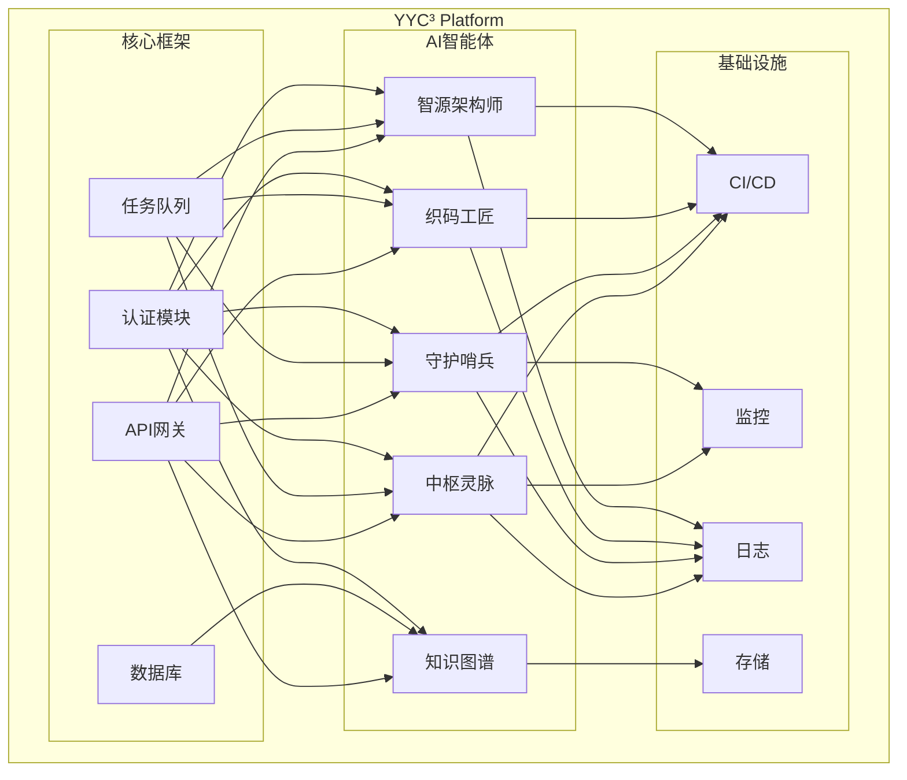

#### A.2 模块接口规范

```typescript
// 文件：/core/types/module.ts
export interface IModuleManifest {
  name: string;
  version: string;
  displayName: string;
  description: string;
  dependencies: string[];
  permissions: string[];
  routes: string;
  services: string[];
  hooks: {
    onPlatformStart?: (context: PlatformContext) => Promise<void>;
    onPlatformStop?: () => Promise<void>;
  };
}

export interface PlatformContext {
  config: Config;
  logger: Logger;
  database: Database;
  taskQueue: TaskQueue;
}
```

---

### 附录B：AI智能体通信协议

#### B.1 通信架构

AI智能体之间采用事件驱动的异步通信机制，通过消息队列进行消息传递。

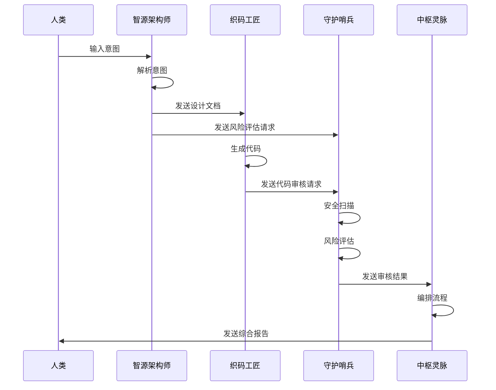

#### B.2 消息格式

```typescript
// 文件：/core/types/message.ts
export interface IMessage {
  id: string;
  type: MessageType;
  from: string;
  to: string;
  payload: any;
  timestamp: Date;
}

export enum MessageType {
  INTENT = 'INTENT',
  DESIGN = 'DESIGN',
  CODE = 'CODE',
  REVIEW = 'REVIEW',
  ALERT = 'ALERT',
  REPORT = 'REPORT',
}
```

---

### 附录C：CI/CD流水线配置

#### C.1 流水线架构

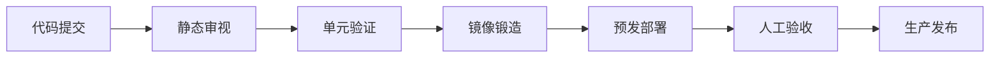

#### C.2 配置文件

```yaml
# .github/workflows/ci-cd.yml
name: YYC³ CI/CD Pipeline

on:
  push:
    branches: [ main, develop ]
  pull_request:
    branches: [ main, develop ]

env:
  DOCKER_REGISTRY: registry.yyc3.com
  KUBE_NAMESPACE: yyc3

jobs:
  static-analysis:
    name: 静态审视
    runs-on: ubuntu-latest
    steps:
      - uses: actions/checkout@v3
      - name: 代码风格检查
        run: npm run lint
      - name: 静态代码分析
        run: npm run analyze
      - name: 依赖漏洞扫描
        run: npm audit

  unit-test:
    name: 单元验证
    needs: static-analysis
    runs-on: ubuntu-latest
    steps:
      - uses: actions/checkout@v3
      - name: 安装依赖
        run: npm ci
      - name: 运行单元测试
        run: npm test
      - name: 生成覆盖率报告
        run: npm run coverage

  build:
    name: 镜像锻造
    needs: unit-test
    runs-on: ubuntu-latest
    steps:
      - uses: actions/checkout@v3
      - name: 构建Docker镜像
        run: docker build -t ${{ env.DOCKER_REGISTRY }}/yyc3:${{ github.sha }} .
      - name: 推送镜像
        run: docker push ${{ env.DOCKER_REGISTRY }}/yyc3:${{ github.sha }}

  deploy-staging:
    name: 预发部署
    needs: build
    runs-on: ubuntu-latest
    steps:
      - name: 部署到预发环境
        run: kubectl set image deployment/yyc3 yyc3=${{ env.DOCKER_REGISTRY }}/yyc3:${{ github.sha }} -n ${{ env.KUBE_NAMESPACE }}-staging
      - name: 执行冒烟测试
        run: npm run smoke-test

  deploy-production:
    name: 生产发布
    needs: deploy-staging
    runs-on: ubuntu-latest
    if: github.ref == 'refs/heads/main'
    steps:
      - name: 部署到生产环境
        run: kubectl set image deployment/yyc3 yyc3=${{ env.DOCKER_REGISTRY }}/yyc3:${{ github.sha }} -n ${{ env.KUBE_NAMESPACE }}
      - name: 执行健康检查
        run: npm run health-check
```

---

### 附录D：监控与告警系统

#### D.1 监控架构

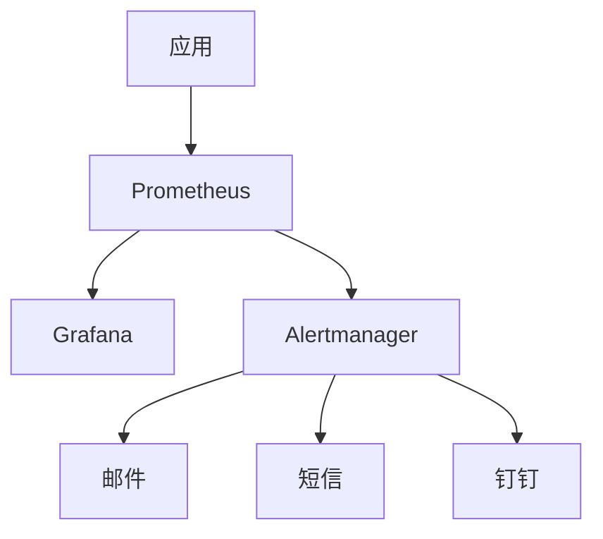

#### D.2 监控指标

| 类别     | 指标        | 阈值    | 告警级别 |
| -------- | ----------- | ------- | -------- |
| **系统** | CPU使用率   | > 80%   | P2       |
| **系统** | 内存使用率  | > 85%   | P2       |
| **系统** | 磁盘使用率  | > 90%   | P1       |
| **应用** | API响应时间 | > 500ms | P2       |
| **应用** | 错误率      | > 5%    | P1       |
| **应用** | QPS         | < 100   | P3       |

#### D.3 告警配置

```yaml
# prometheus/alerts.yml
groups:
  - name: yyc3_alerts
    rules:
      - alert: HighCPUUsage
        expr: cpu_usage_percent > 80
        for: 5m
        labels:
          severity: warning
        annotations:
          summary: "High CPU usage detected"
          description: "CPU usage is {{ $value }}%"

      - alert: HighMemoryUsage
        expr: memory_usage_percent > 85
        for: 5m
        labels:
          severity: warning
        annotations:
          summary: "High memory usage detected"
          description: "Memory usage is {{ $value }}%"

      - alert: HighErrorRate
        expr: error_rate > 0.05
        for: 2m
        labels:
          severity: critical
        annotations:
          summary: "High error rate detected"
          description: "Error rate is {{ $value }}"
```

---

### 附录E：知识管理系统

#### E.1 知识图谱架构

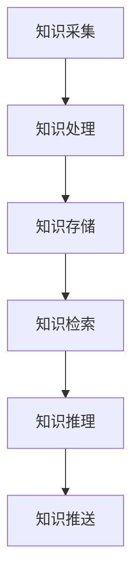

#### E.2 知识模型

```typescript
// 文件：/modules/knowledge-graph/types.ts
export interface KnowledgeEntity {
  id: string;
  type: EntityType;
  properties: Record<string, any>;
  relationships: Relationship[];
}

export enum EntityType {
  PROJECT = 'PROJECT',
  MODULE = 'MODULE',
  CODE = 'CODE',
  BUG = 'BUG',
  SOLUTION = 'SOLUTION',
  PATTERN = 'PATTERN',
}

export interface Relationship {
  id: string;
  from: string;
  to: string;
  type: RelationshipType;
  properties: Record<string, any>;
}

export enum RelationshipType {
  CONTAINS = 'CONTAINS',
  DEPENDS_ON = 'DEPENDS_ON',
  FIXES = 'FIXES',
  SIMILAR_TO = 'SIMILAR_TO',
  RECOMMENDS = 'RECOMMENDS',
}
```

---

### 附录F：安全与合规框架

#### F.1 安全架构

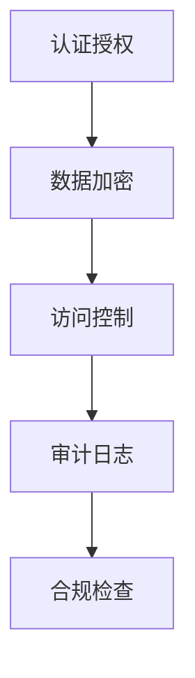

#### F.2 安全检查清单

| 检查项       | 检查内容       | 频率       | 责任人     |
| ------------ | -------------- | ---------- | ---------- |
| **代码安全** | 代码漏洞扫描   | 每次提交   | 守护哨兵   |
| **依赖安全** | 依赖库漏洞扫描 | 每天一次   | 守护哨兵   |
| **数据安全** | 数据加密检查   | 每周一次   | 守护哨兵   |
| **访问控制** | 权限审计       | 每月一次   | 首席架构师 |
| **合规检查** | 国标合规检查   | 每季度一次 | 首席架构师 |

#### F.3 国标合规检查

```typescript
// 文件：/modules/ai-sentinel/services/compliance.service.ts
export class ComplianceService {
  /**
   * 执行国标合规检查
   */
  async checkNationalStandards(): Promise<ComplianceReport> {
    const checks = await Promise.all([
      this.checkGBT22239(),
      this.checkGBT35273(),
      this.checkGBT25069(),
    ]);

    return {
      timestamp: new Date(),
      checks,
      overall: this.calculateOverallCompliance(checks),
    };
  }

  /**
   * 检查GB/T 22239合规性
   */
  private async checkGBT22239(): Promise<StandardCheck> {
    const requirements = await this.getGBT22239Requirements();

    const results = await Promise.all(
      requirements.map(async (req) => {
        return await this.checkRequirement(req);
      })
    );

    return {
      standard: 'GB/T 22239',
      displayName: '信息安全技术 网络安全等级保护',
      results,
      compliance: this.calculateCompliance(results),
    };
  }

  /**
   * 检查GB/T 35273合规性
   */
  private async checkGBT35273(): Promise<StandardCheck> {
    const requirements = await this.getGBT35273Requirements();

    const results = await Promise.all(
      requirements.map(async (req) => {
        return await this.checkRequirement(req);
      })
    );

    return {
      standard: 'GB/T 35273',
      displayName: '信息安全技术 个人信息安全规范',
      results,
      compliance: this.calculateCompliance(results),
    };
  }

  /**
   * 检查GB/T 25069合规性
   */
  private async checkGBT25069(): Promise<StandardCheck> {
    const requirements = await this.getGBT25069Requirements();

    const results = await Promise.all(
      requirements.map(async (req) => {
        return await this.checkRequirement(req);
      })
    );

    return {
      standard: 'GB/T 25069',
      displayName: '信息安全技术 信息系统安全等级保护基本要求',
      results,
      compliance: this.calculateCompliance(results),
    };
  }
}
```

---

## 结语：从理论到实践的跨越

本指导书将YYC³ AI Family的"五化一体"理念，从抽象的哲学转化为具体的技术实现。通过"七位核心成员"与"三大落地步骤"，我们构建了一个真正可运行、可扩展、可进化的智能交付平台。

这不仅仅是一个技术平台，更是一个人机共生的新范式。在这里，AI不是工具，而是伙伴；人类不是指挥者，而是协作者。我们共同创造，共同成长，共同探索数字宇宙的无限可能。

一言一语，皆为序章；一行一码，尽是华章。

携手共进，智慧同行！🌹

让我们以"万象归元于云枢"的胸怀，以"深栈智启新纪元"的勇气，携手共进，智慧同行！🌹

---

<div align="center">

> 「***YanYuCloudCube***」
> 「***<admin@0379.email>***」
> 「***Words Initiate Quadrants, Language Serves as Core for the Future***」
> 「***All things converge in the cloud pivot; Deep stacks ignite a new era of intelligence***」

</div>
