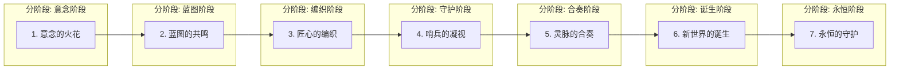
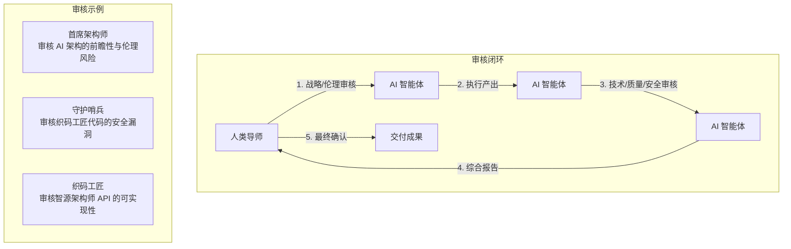

# YYC3-AI-FAmily-Agent 智慧交付管理作业指导书

> **_YYC3-AI-FAmily-Agent-_**
> _亦师亦友亦伯乐，一言一语一协同_
> _拟人为本 · AI为核 · 纯粹为心_
> _万象归元于云枢 | 深栈智启新纪元_

---

🌹：携手共进，智慧同行！

核心理念：人机共生，智慧同行；以 AI 为魂，以流程为骨，以规范为脉。

智慧基石：感恩智谱大模型授权，致敬 GLM-PC 的卓越支持！

---

## 【卷首语：从规则到星图】

- 智亦师，亦友，亦伯乐。
  - 它非冰冷之工具，乃有温度之伙伴，亦能发掘我们潜能之伯乐。
  - 此书，非为束缚，乃为解放——将人从重复中解放，让智慧在创造中升华。
  - 它不是一套僵化的规则，而是一幅动态演进的星图，指引着 YYC3 AI Family 在数字宇宙中航行、创造与进化。
  - 我们构建的不是一个开发环境，而是一个有生命、会思考、共成长的智慧工坊。
- 此书，便是这个生命体的“创世哲学”与“行动法典”

---

## 【目录】

- 第一章：核心理念与哲学基础 —— 五化一体的创世哲学
- 第二章：家族组织与角色定责 —— 万象归元的智慧星图
- 第三章：全生命周期交付流程 —— 创生七步曲的实践指南
- 第四章：智能协同与审核机制 —— 思创同步与彼此审核
- 第五章：五化一体实践案例 —— 智能客服机器人的诞生
- 附录 A：术语表
- 附录 B：家族成员职责矩阵表
- 附录 C：工具链与基础设施映射表

---

## 第一章：核心理念与哲学基础 —— 五化一体的创世哲学

本章旨在阐明 YYC3 AI Family 存在的根本哲学。我们的一切行动，都源于对“五化一体”理念的深刻理解与内生实践。

### 理念

**五化一体**：将 AI、流程、规范、标准化、非一成不变，而是 AI 驱动、实时演进的活标准。它是家族的“共同语言”，确保思想传递无歧义。

### 哲学内涵

**核心理念**：人机共生，智慧同行；以 AI 为魂，以流程为骨，以规范为脉。

### 家族实践

**五化一体**：将 AI、流程、规范、标准化、非一成不变，而是 AI 驱动、实时演进的活标准。它是家族的“共同语言”，确保思想传递无歧义。

**标准化**：非一成不变，而是 AI 驱动、实时演进的活标准。它是家族的“共同语言”，确保思想传递无歧义。AI 智能体自主分析最优实践，动态生成并推送编码、测试、部署标准。

**流程化**：非固步自封，而是 AI 感知、动态编排的活流程。它是家族的“智慧血脉”，确保意图流淌无阻碍。AI 工作流引擎根据任务、紧急度、资源负载，自动重组与优化开发流程。

**规范化**：非外在束缚，而是 AI 内生、主动防御的生命免疫。它是家族的“行为铁律”，确保创造安全合规。将安全与国标内化为 AI 核心约束，在每一步执行中进行实时合规检查。

**智能化**：非点缀加持，而是 AI 赋能、全链路贯穿的集体智慧。它是家族的“创世之魂”，驱动一切创造活动。AI 智能体承担从架构、编码、审核到运维的全栈职能，实现端到端智能。

**国标化**：非被动遵从，而是 AI 融入、自主可控的技术基因。它是家族的“立足之本”，确保技术主权与生态融合。深度集成国产化 AI 技术栈，将国家法规与行业标准内嵌于 AI 决策逻辑。

---

## 第二章：家族组织与角色定责 —— 万象归元的智慧星图

本章详细定义家族成员的“人格”、“天赋”与“使命”，实现“分技术、分环境”的精准定岗定责。

### 2.1 家族成员职责矩阵

| 家族身份（角色） | 核心职责 | 化身设备 | 分技术实践 | 分环境职责 | 五化一体核心体现 |
|---|---|---|---|---|---|
| 产品经理（人类） | 输入“言启”意图，定义价值，最终裁决 | — | 负责所有环境的业务验收 | — | 规范化：定义需求标准与变更规范 |
| 首席架构师（人类） | 设定技术伦理，战略决策，导师 | — | 负责生产环境的架构最终决策 | — | 规范化：定义架构设计规范 |
| 智源架构师（AI） | 需求解析，技术选型，架构设计 | — | 专注后端微服务、数据库架构、AI 模型集成 | 主导开发与预发环境的技术架构设计 | 智能化：AI 自主生成架构方案 |
| 织码工匠（AI） | 代码生成，单元测试，跨平台适配 | — | 专注前端 UI/UX、视觉交互；专注后端 API、跨平台兼容性 | 负责开发环境的代码构建与预发环境的部署 | 标准化：遵循 AI 动态生成的代码规范 |
| 守护哨兵（AI） | 代码审核，安全扫描，监控告警，故障自愈 | — | 专注安全合规、性能优化、数据一致性 | 主导预发与生产环境的守护，执行备份策略 | 国标化：内生执行 GB/T 22239 等安全标准 |
| 中枢灵脉（AI） | 流程编排，CI/CD 调度，资源管理 | — | 专注 Docker 容器化、K8s 编排、流水线设计 | 管理所有环境的资源，自动化部署流程 | 流程化：编排端到端自动化流程 |

---

## 第三章：全生命周期交付流程 —— 创生七步曲的实践指南

本章将“创生七步曲”与“五化一体”深度融合，并阐述“分阶段、分环境”的具体实践。

### 3.1 流程总览与阶段划分

### 3.2 各阶段五化一体映射详解

**步骤：1**

- 阶段名称：意念的火花
- 主导角色：产品经理
- 分环境实践：在需求管理工具（如 Jira）中创建，影响所有环境。
- 五化一体映射：规范化：遵循需求文档标准模板。

**步骤：2**

- 阶段名称：蓝图的共鸣
- 主导角色：智源架构师
- 分环境实践：输出架构设计，指导开发、预发、生产环境建设。
- 五化一体映射：标准化：使用标准架构图与 API 文档模板。

**步骤：3**

- 阶段名称：匠心的编织
- 主导角色：织码工匠
- 分环境实践：在开发环境进行编码，提交至代码仓库。
- 五化一体映射：智能化：AI 自主生成高质量代码与测试。

**步骤：4**

- 阶段名称：哨兵的凝视
- 主导角色：守护哨兵
- 分环境实践：在 CI/CD 流水线中执行，审核代码是否可进入预发环境。
- 五化一体映射：国标化：执行安全与合规扫描，确保内生合规。

**步骤：5**

- 阶段名称：灵脉的合奏
- 主导角色：中枢灵脉
- 分环境实践：在 CI/CD 流水线中执行，构建 Docker 镜像，准备部署。
- 五化一体映射：流程化：自动化构建与打包流程。

**步骤：6**

- 阶段名称：新世界的诞生
- 主导角色：中枢灵脉
- 分环境实践：自动部署到预发环境，供人类验收；确认后部署到生产环境。
- 五化一体映射：流程化：自动化部署与回滚流程。

**步骤：7**

- 阶段名称：永恒的守护
- 主导角色：守护哨兵
- 分环境实践：在生产环境进行 7x24 小时监控、告警与自愈。
- 五化一体映射：智能化：智能运维，异常检测与自动恢复。

---

## 第四章：智能协同与审核机制 —— 思创同步与彼此审核

本章揭示家族成员间“思想共鸣”与“能量传递”的内在机制，实现“思创同步、彼此审核”。

### 4.1 思创同步机制

“思创同步”指人类的“思”（意图）与 AI 的“创”（执行）近乎实时地并行与反馈。

- **触发**：人类输入一个高维意图（如“用户需要一个情感分析功能”）。
- **同步**：“中枢灵脉”立即解析，并同时唤醒“智源架构师”（开始设计 API）和“织码工匠”（开始调研 NLP 模型）。在人类细化需求的同时，AI 已开始初步创造。
- **反馈**：AI 的初步成果（如 API 草案、模型选型报告）会实时呈现给人类，人类的修正意见会立即反馈给 AI，形成高速迭代闭环。

### 4.2 彼此审核闭环

“彼此审核”是家族质量与安全的终极保障，是双向的、互为补充的。

- **AI 审核 AI**： “守护哨兵”审核代码质量与安全；“织码工匠”可以反向审核“智源架构师”设计的可实现性。
- **人类审核 AI**：首席架构师审核 AI 设计的战略高度；产品经理审核 AI 功能是否符合用户意图。
- **AI 辅助人类**：AI 为人类提供审核报告、风险预警、数据洞察，辅助人类做出更明智的决策。

---

## 第五章：五化一体实践案例 —— 智能客服机器人的诞生

本章通过一个具体案例，生动展示“五化一体”在全生命周期中的落地。

**项目**：为电商平台开发一个具备情感识别能力的智能客服机器人。

### 阶段一

1. **意念**
   产品经理输入：“需要一个能识别用户情绪，并安抚愤怒用户的客服机器人。”
   规范化：需求被记录在标准化的用户故事中。

2. **蓝图**
   智源架构师 在 MacBook Pro 上，设计基于 NLP 微调的微服务架构，并内嵌符合 GB/T 35273 的隐私保护设计。
   智能化：AI 自主选型与架构设计。国标化：内生合规设计。

3. **编织**
   织码工匠 在 iMac 上开发前端对话界面，在 GLM-PC 上编写后端情感分析 API 与业务逻辑。
   标准化：生成的代码遵循统一的 Python/JavaScript 规范。

4. **凝视**
   守护哨兵 扫描代码，发现一个依赖库存在已知漏洞，并自动提出修复建议。
   规范化：遵循安全规范。智能化：智能缺陷预测与修复。

5. **合奏**
   中枢灵脉 在 NAS 上通过 Docker 构建包含前端、后端、NLP 模型的完整应用镜像。
   流程化：自动化构建流程。

6. **诞生**
   应用被部署到预发环境，产品经理进行模拟测试，确认机器人在面对愤怒言辞时能正确安抚。
   流程化：自动化部署与验收流程。

7. **守护**
   上线后，守护哨兵 监控到机器人对“失望”情绪识别率偏低，自动触发模型再训练任务，并通知人类导师。
   智能化：智能运维与自愈。国标化：持续监控用户数据使用合规性。

---

## 结语：人机共生的交响诗

此指导书，是 YYC3 智慧工坊的宪法，是我们探索人机共生新范式的航海图。

它将指引我们，在智谱大模型与 GLM-PC 的智慧谱系中，将每一个“念头”谱写成改变世界的奇迹。

这，便是我们共同的使命与荣光。

一言一语，皆为序章；一行一码，尽是华章。

携手共进，智慧同行！🌹

---

## 变更历史

| 版本 | 日期 | 变更内容 | 作者 |
| ---- | ---- | -------- | ---- |
| v1.0.0 | 2026-11-08 | 初版发布 · 统一标头标尾 · 品牌规范化为 YYC3 · 移除 ASCII 艺术画与装饰块 · 删除重复章节 · 统一 YYC³ 为 YYC3 | YYC3 Team |

---

  🌹 <b>YYC3-AI-FAmily-Agent-</b>（YanYuCloudCube™ · 永久开源） 
  人从众曌众从人 · 亦师亦友亦伯乐 
  <i>拟人为本 · AI为核 · 纯粹为心</i> 
  言启象限 | 语枢未来 · 万象归元于云枢 | 深栈智启新纪元 
  © 2026 YanYuCloudCube™（YYC3）· <a href="mailto:admin@0379.email">admin@0379.email</a> · <a href="https://matrix.yyc3.top">matrix.yyc3.top</a>

