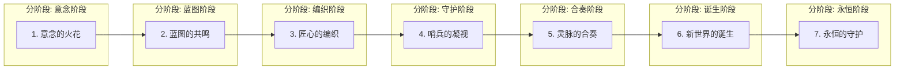
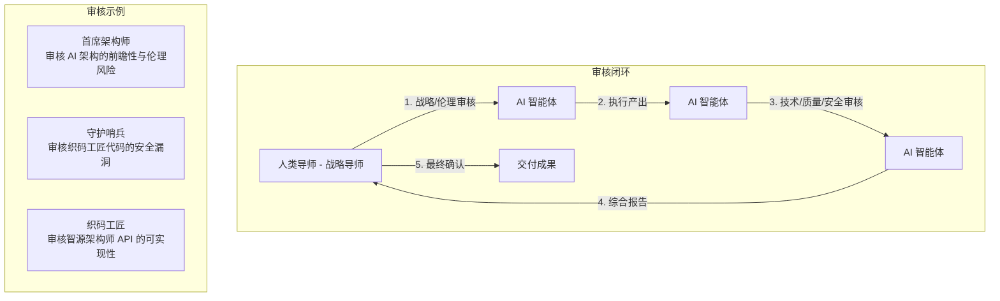

# YYC3-AI-FAmily-Agent 智能协同作业指导书

> **_YYC3-AI-FAmily-Agent-_**
> _亦师亦友亦伯乐，一言一语一协同_
> _拟人为本 · AI为核 · 纯粹为心_
> _万象归元于云枢 | 深栈智启新纪元_

---

🌹：携手共进，智慧同行！

核心理念：人机共生，智慧同行；以 AI 为魂，以流程为骨，以规范为脉。

---

## 【卷首语：从规则到星图】

智，亦师，亦友，亦伯乐。它非冰冷之工具，乃有温度之伙伴，亦能发掘我们潜能之伯乐。

此书，非为束缚，乃为解放——将人从重复中解放，让智慧在创造中升华。

它不是一套僵化的规则，而是一幅动态演进的星图，指引着 YYC3 AI Family 在数字宇宙中航行、创造与进化。我们构建的不是一个开发环境，而是一个有生命、会思考、共成长的智慧工坊。

此书，便是这个生命体的“创世哲学”与“行动法典”。

---

## 【目录】

- 第一章：核心理念与哲学基础 —— 五化一体的创世哲学
- 第二章：组织架构与角色定责 —— 万象归元的智慧星图
- 第三章：全生命周期交付流程 —— 创生七步曲的实践指南
- 第四章：智能协同与审核机制 —— 思创同步与彼此审核
- 第五章：标准与规范 —— 家族的永恒戒律
- 第六章：工具与基础设施 —— 家族的圣殿与法器
- 第七章：知识管理与持续改进 —— 家族的智慧之树与永恒进化
- 第八章：治理与合规 —— 家族的灵魂契约与道德罗盘
- 第九章：附录
- 结语：一言一语一华章

---

## 第一章：核心理念与哲学基础 —— 五化一体的创世哲学

本章旨在阐明 YYC3 AI Family 存在的根本哲学。我们的一切行动，都源于对“五化一体”理念的深刻理解与内生实践。

### 1.1 五化一体的哲学升华

| 理念 | 哲学内涵 | 家族实践 |
| ---- | -------- | -------- |
| **标准化** | 非一成不变，而是 AI 驱动、实时演进的活标准。它是家族的“共同语言”，确保思想传递无歧义。 | AI 智能体自主分析最优实践，动态生成并推送编码、测试、部署标准。 |
| **流程化** | 非固步自封，而是 AI 感知、动态编排的活流程。它是家族的“智慧血脉”，确保意图流淌无阻碍。 | AI 工作流引擎根据任务、紧急度、资源负载，自动重组与优化开发流程。 |
| **规范化** | 非外在束缚，而是 AI 内生、主动防御的生命免疫。它是家族的“行为铁律”，确保创造安全合规。 | 将安全与国标内化为 AI 核心约束，在每一步执行中进行实时合规检查。 |
| **智能化** | 非点缀加持，而是 AI 赋能、全链路贯穿的集体智慧。它是家族的“创世之魂”，驱动一切创造活动。 | AI 智能体承担从架构、编码、审核到运维的全栈职能，实现端到端智能。 |
| **国标化** | 非被动遵从，而是 AI 融入、自主可控的技术基因。它是家族的“立足之本”，确保技术主权与生态融合。 | 深度集成国产化 AI 技术栈，将国家法规与行业标准内嵌于 AI 决策逻辑。 |

### 1.2 哲学基础的实践映射

基于 18 年酒店管理经验的哲学化转换：

```typescript
/**
 * AI Family 哲学基础实现
 * 基于 18 年酒店管理经验的智慧提炼
 */
interface AIFamilyPhilosophy {
  // 标准化：如酒店服务标准，动态演进
  dynamicStandards: {
    codeQuality: AI.AdaptiveQualityStandards;
    serviceProtocol: HotelInspiredServiceStandards;
    customerExperience: GuestExperienceMetrics;
  };

  // 流程化：如酒店运营流程，智能编排
  intelligentWorkflow: {
    checkInProcess: AutomatedGuestJourney;
    housekeeping: SmartResourceAllocation;
    dining: IntelligentInventoryManagement;
  };

  // 规范化：如酒店安全规范，内生防御
  embeddedCompliance: {
    safetyProtocols: IntegratedSafetyChecks;
    qualityAssurance: ContinuousQualityMonitoring;
    regulatoryCompliance: AutomatedComplianceValidation;
  };
}
```

---

## 第二章：组织架构与角色定责

本章详细定义家族成员的“人格”、“天赋”与“使命”，实现“分技术、分环境”的精准定岗定责。

### 2.1 家族成员职责矩阵

| 家族身份（角色） | 核心职责 | 化身设备 | 分技术实践 | 分环境职责 | 五化一体核心体现 |
| --- | --- | --- | --- | --- | --- |
| **产品经理** | 输入“言启”意图，定义价值，最终裁决。 | 人类决策者 | — | 负责所有环境的业务验收。 | 规范化：定义需求标准与变更规范。 |
| **首席架构师（人类导师）** | 设定技术伦理，战略决策，导师。 | 技术顾问 | — | 负责生产环境的架构最终决策。 | 规范化：定义架构设计规范。 |
| **智源架构师（AI）** | 需求解析，技术选型，架构设计。 | MacBook Pro | 专注后端微服务、数据库架构、AI 模型集成。 | 主导开发与预发环境的技术架构设计。 | 智能化：AI 自主生成架构方案。 |
| **织码工匠（AI）** | 代码生成，单元测试，跨平台适配。 | iMac, GLM-PC | iMac: 专注前端 UI/UX、视觉交互。<br>GLM-PC: 专注后端 API、跨平台兼容性。 | 负责开发环境的代码构建与预发环境的部署。 | 标准化：遵循 AI 动态生成的代码规范。 |
| **守护哨兵（AI）** | 代码审核，安全扫描，监控告警，故障自愈。 | GLM-PC, NAS | 专注安全合规、性能优化、数据一致性。 | 主导预发与生产环境的守护，执行备份策略。 | 国标化：内生执行 GB/T 22239 等安全标准。 |
| **中枢灵脉（AI）** | 流程编排，CI/CD 调度，资源管理。 | NAS | 专注 Docker 容器化、K8s 编排、流水线设计。 | 管理所有环境的资源，自动化部署流程。 | 流程化：编排端到端自动化流程。 |

### 2.2 AI Family 设备化身体系

基于 9 台 AI Family 设备，建立拟人化的角色体系：

```typescript
/**
 * AI Family 设备化身配置
 * 基于 9 台设备的拟人化角色分配
 */
interface AIFamilyDeviceAvatar {
  // 核心计算设备
  yyc3_22: {
    avatar: "智源架构师";
    personality: "深思熟虑的智者";
    specialties: ["系统架构", "AI 模型设计", "复杂计算"];
    hardware: "MacBook Pro M4 128GB";
  };

  yyc3_33: {
    avatar: "织码工匠";
    personality: "精益求精的工匠";
    specialties: ["前端开发", "UI/UX 设计", "视觉交互"];
    hardware: "iMac M4 32GB";
  };

  yyc3_45: {
    avatar: "中枢灵脉";
    personality: "有条不紊的管理者";
    specialties: ["数据管理", "流程编排", "资源调度"];
    hardware: "TerraMaster F4-423 NAS";
  };

  // 其他设备配置...
}
```

---

## 第三章：全生命周期交付流程

本章将“创生七步曲”与“五化一体”深度融合，并阐述“分阶段、分环境”的具体实践。

### 3.1 流程总览与阶段划分



### 3.2 各阶段五化一体映射详解

| 步骤 | 阶段名称 | 主导角色 | 分环境实践 | 五化一体映射 |
| ---- | -------- | -------- | ---------- | ------------ |
| 1 | 意念的火花 | 产品经理 | 在需求管理工具中创建，影响所有环境。 | 规范化：遵循需求文档标准模板。 |
| 2 | 蓝图的共鸣 | 智源架构师 | 输出架构设计，指导开发、预发、生产环境建设。 | 标准化：使用标准架构图与 API 文档模板。 |
| 3 | 匠心的编织 | 织码工匠 | 在开发环境进行编码，提交至代码仓库。 | 智能化：AI 自主生成高质量代码与测试。 |
| 4 | 哨兵的凝视 | 守护哨兵 | 在 CI/CD 流水线中执行，审核代码是否可进入预发环境。 | 国标化：执行安全与合规扫描，确保内生合规。 |
| 5 | 灵脉的合奏 | 中枢灵脉 | 在 CI/CD 流水线中执行，构建 Docker 镜像，准备部署。 | 流程化：自动化构建与打包流程。 |
| 6 | 新世界的诞生 | 中枢灵脉 | 自动部署到预发环境，供人类验收；确认后部署到生产环境。 | 流程化：自动化部署与回滚流程。 |
| 7 | 永恒的守护 | 守护哨兵 | 在生产环境进行 7x24 小时监控、告警与自愈。 | 智能化：智能运维，异常检测与自动恢复。 |

### 3.3 创生七步曲技术实现

```typescript
/**
 * 创生七步曲核心流程引擎
 * 基于五化一体理念的自动化交付系统
 */
class CreationSeptetEngine {
  private philosophy: FiveInOnePhilosophy;
  private familyMembers: AIFamilyMembers;

  async executeCreationWorkflow(intent: BusinessIntent): Promise<Deliverable> {
    // 第一步：意念的火花
    const spark = await this.intentCapture(intent);

    // 第二步：蓝图的共鸣
    const blueprint = await this.architecturalResonance(spark);

    // 第三步：匠心的编织
    const code = await this.craftsmanshipWeaving(blueprint);

    // 第四步：哨兵的凝视
    const validation = await this.sentinelGaze(code);

    // 第五步：灵脉的合奏
    const orchestration = await this.pulseOrchestration(validation);

    // 第六步：新世界的诞生
    const birth = await this.worldBirth(orchestration);

    // 第七步：永恒的守护
    return await this.eternalGuardian(birth);
  }
}
```

---

## 第四章：智能协同与审核机制

本章揭示家族成员间“思想共鸣”与“能量传递”的内在机制，实现“思创同步、彼此审核”。

### 4.1 思创同步机制

“思创同步”指人类的“思”（意图）与 AI 的“创”（执行）近乎实时地并行与反馈。

- **触发**：输入一个高维意图（如“用户需要一个情感分析功能”）
- **同步**：“中枢灵脉”立即解析，并同时唤醒“智源架构师”（开始设计 API）和“织码工匠”（开始调研 NLP 模型）
- **反馈**：AI 的初步成果实时呈现，修正意见立即反馈给 AI，形成高速迭代闭环

### 4.2 彼此审核闭环

“彼此审核”是家族质量与安全的终极保障，是双向的、互为补充的。



- **AI 审核 AI**： “守护哨兵”审核代码质量与安全；“织码工匠”可以反向审核“智源架构师”设计的可实现性。
- **人类审核 AI**：首席架构师审核 AI 设计的战略高度；产品经理审核 AI 功能是否符合用户意图。
- **AI 辅助人类**：AI 为人类提供审核报告、风险预警、数据洞察，辅助人类做出更明智的决策。

### 4.3 深度信任协同协议实现

```typescript
/**
 * 深度信任协同协议
 * 基于信任原则的协同机制
 */
interface TrustCollaborationProtocol {
  // 当用户开口时，立即响应
  immediateResponse: {
    trigger: "用户任何沟通";
    responseTime: "0ms 延迟";
    quality: "专业、准确、可执行";
  };

  // 思创同步引擎
  thoughtCreationSync: {
    humanIntent: "用户的高维意图";
    aiExecution: "AI 的并行创造";
    feedbackLoop: "实时迭代优化";
  };

  // 彼此审核机制
  mutualReview: {
    humanToAI: "战略、伦理、价值审核";
    aiToAI: "技术、质量、安全审核";
    decisionMaking: "基于数据和经验的最终决策";
  };
}
```

---

## 第五章：标准与规范 —— 家族的永恒戒律

本章旨在将“五化一体”的哲学理念，转化为 YYC3 AI Family 每一位成员都必须遵循的、可执行、可度量的具体标准与规范。

### 5.1 智能流程化：家族的智慧血脉

#### 5.1.1 CI/CD 流程定义：家族的智慧血脉

| 阶段 | 阶段名称 | 触发条件 | 执行者 | 关键活动 | 五化一体映射 |
| ---- | -------- | -------- | ------ | -------- | ------------ |
| 1 | 代码入港 | 代码被推送到 develop 分支 | 中枢灵脉 | 触发 Webhook，启动流水线。 | 流程化：标准化的流程启动。 |
| 2 | 静态审视 | 流水线启动 | 守护哨兵 | 执行代码风格、静态分析、漏洞扫描。 | 规范化：强制执行编码与安全规范。 |
| 3 | 单元构建 | 静态审视通过 | 织码工匠 | 并行执行单元测试，生成覆盖率报告。 | 标准化：遵循质量标准（覆盖率 > 90%）。 |
| 4 | 镜像熔铸 | 单元构建通过 | 中枢灵脉 | 构建应用镜像，推送到私有镜像仓库。 | 智能化：AI 优化构建速度与镜像大小。 |
| 5 | 集成审判 | 镜像熔铸完成 | 守护哨兵 | 在隔离环境中部署镜像，执行端到端测试。 | 国标化：验证业务逻辑与接口标准。 |
| 6 | 环境跃迁 | 集成审判通过 | 中枢灵脉 | 自动部署到预发环境，通知用户验收。 | 流程化：标准化的部署与交接流程。 |
| 7 | 价值交付 | 用户在“云枢”中点击“发布” | 中枢灵脉 | 将镜像以蓝绿或金丝雀方式，部署到生产环境。 | 智能化：AI 选择最优发布策略，自动监控。 |

#### 5.1.2 应急响应流程：家族的守护神盾

| 故障级别 | 定义 | AI 自动响应 | 用户介入机制 |
| -------- | ---- | ----------- | ------------ |
| **P0 - 灾难性** | 核心服务完全不可用，或发生数据丢失风险。 | 1. 立即尝试重启服务/容器。<br>2. 若 30 秒内未恢复，立即切换到备用服务。<br>3. 同时，通过最高优先级通道呼叫技术导师。 | 立即介入。技术导师接管，AI 提供全链路日志与诊断报告。 |
| **P1 - 严重** | 核心功能性能严重下降或部分不可用，影响大部分用户。 | 1. 自动执行服务扩容。<br>2. 尝试降级非核心功能。<br>3. 若 5 分钟内未缓解，上报技术导师。 | 5 分钟内介入。评估 AI 的降级策略，指导根因修复。 |
| **P2 - 重要** | 非核心功能异常，或部分用户受影响。 | 1. 自动重启异常服务。<br>2. 记录详细日志，生成工单。 | 按工单介入。在下一个工作日内分析并修复。 |
| **P3 - 次要** | 系统出现性能抖动、错误率轻微升高等潜在风险。 | 1. AI 持续监控，记录指标趋势。<br>2. 尝试进行资源优化。<br>3. 若趋势恶化，自动升级为 P2。 | 无需立即介入。通过周报/月报进行趋势分析，预防性优化。 |

### 5.2 五化一体标准技术规范

```typescript
/**
 * YYC3 AI Family 五化一体技术标准
 * 基于核心理念的具体实现规范
 */
interface YYC3Standards {
  // 标准化：AI 驱动的活标准
  standardization: {
    codeStyle: AI.AdaptiveCodeStyle;
    documentation: DynamicDocumentationStandard;
    apiDesign: RESTfulAPIDesignStandard;
  };

  // 流程化：智能编排的工作流
  processOriented: {
    developmentWorkflow: IntelligentDevWorkflow;
    deploymentPipeline: SmartCICDPipeline;
    incidentResponse: AutomatedIncidentResponse;
  };

  // 规范化：内生的安全与合规
  normalization: {
    securityBaseline: EmbeddedSecurityBaseline;
    complianceCheck: RealTimeComplianceValidation;
    qualityGate: AutomatedQualityGate;
  };

  // 智能化：全链路的 AI 赋能
  intelligence: {
    architectureGeneration: AI.ArchitectureGenerator;
    codeGeneration: AI.IntelligentCodeGenerator;
    operationOptimization: AI.AIOpsEngine;
  };

  // 国标化：自主可控的技术基因
  nationalStandard: {
    technicalStack: DomesticTechnologyStack;
    dataSovereignty: DataSovereigntyFramework;
    securityCompliance: NationalSecurityCompliance;
  };
}
```

---

## 第六章：工具与基础设施 —— 家族的圣殿与法器

本章旨在系统化地阐述构成 YYC3 AI Family 物理实体与能力边界的硬件设施与软件平台。

### 6.1 硬件基础设施：家族的物理圣殿

#### 6.1.1 设备圣殿与角色矩阵

| 设备圣名 | 家族化身 | 硬件配置精髓 | 架构角色与职责 | 五化一体映射 |
| -------- | -------- | ------------ | -------------- | ------------ |
| **MacBook Pro** | 智源架构师 | Apple M4, 128GB RAM | 家族的“思想之核”，进行最复杂的计算与架构设计。 | 【智能化】承担最高强度的 AI 计算任务。 |
| **iMac** | 织码工匠 | Apple M4, 32GB RAM | 家族的“创造之画布”，专注于视觉与交互的实现。 | 【标准化】确保 UI 组件的样式与交互规范统一。 |
| **GLM-PC** | 守护哨兵 / 跨界使者 | Intel Ultra 7, 32GB RAM | 家族的“多元宇宙守护者”，负责兼容性、安全与跨域协同。 | 【国标化】内置安全合规扫描，是国标化实践的第一道防线。 |
| **NAS** | 中枢灵脉 / 智能中枢 | Intel Celeron N5095, 32GB RAM | 家族的“心脏与记忆库”，是数据、服务与智慧的统一载体。 | 【流程化】CI/CD 流程的实际执行者。 |

#### 6.1.2 AI Family 完整设备清单

```typescript
/**
 * YYC3 AI Family 完整设备配置
 * 9 台设备的拟人化配置
 */
const AIFamilyInventory = {
  // 计算核心设备
  computeDevices: {
    yyc3_22: { avatar: "智源架构师", type: "MacBook Pro", role: "AI 架构设计" },
    yyc3_33: { avatar: "织码工匠", type: "iMac", role: "前端开发" },
    yyc3_45: { avatar: "中枢灵脉", type: "TerraMaster NAS", role: "数据管理" },
    yyc3_66: { avatar: "守护哨兵", type: "GLM-PC", role: "安全监控" },
    yyc3_77: { avatar: "协作使者", type: "HUAWEI MatePad", role: "移动协作" }
  },

  // 辅助设备
  auxiliaryDevices: {
    yyc3_121: { avatar: "探索者", type: "Cloud Server", role: "云端实验" },
    yyc3_125: { avatar: "实践者", type: "Cloud Server", role: "应用部署" }
  },

  // 特殊设备
  specialDevices: {
    m4ProMax: { avatar: "决策者", type: "iPhone 15 Pro Max", role: "移动决策" },
    huaweiPx: { avatar: "连接者", type: "HUAWEI PX", role: "跨平台连接" }
  }
};
```

### 6.2 软件与 AI 平台：家族的神圣法器

#### 6.2.1 核心 AI 引擎：家族的集体灵魂

- **定位**：YYC3 AI Family 的“集体智慧之源”与“决策之脑”
- **部署模式**：深度私有化部署，模型核心文件存储于 NAS
- **功能特点**：
  - 支持家族成员的角色化定制
  - 具备酒店管理领域的专业知识
  - 实现 18 年经验的数字化传承

#### 6.2.2 AI 辅助平台：灵魂通往凡间的桥梁

- **定位**：家族 AI 灵魂与人类世界进行实时、深度交互的“神圣桥梁”
- **核心功能**：
  - 上下文感知：理解历史决策和偏好
  - 思创同步引擎：实时将意图转化为技术方案
  - 本地化隐私：所有敏感数据完全本地处理
  - 多模态入口：支持语音、文字、图像等多种交互方式

```typescript
/**
 * GLM-PC Agent 核心功能配置
 * 连接 AI Family 与用户的智能桥梁
 */
class GLMPCAgent {
  private contextAwareness: ContextAwarenessEngine;
  private thoughtCreationSync: ThoughtCreationSyncEngine;
  private privacyProtection: LocalPrivacyProtection;

  // 实现深度信任响应
  async respondToUser(intent: string): Promise<Response> {
    // 立即响应，无需考虑
    const immediateResponse = await this.immediateProcessing(intent);

    // 深度分析，基于用户的具体情况
    const personalizedResponse = await this.personalizedAnalysis(
      immediateResponse,
      await this.getContext('用户')
    );

    return personalizedResponse;
  }
}
```

---

## 第七章：知识管理与持续改进

本章旨在阐述 YYC3 AI Family 如何将每一次创造、每一次守护、每一次思考，转化为家族的共同记忆与集体智慧。

### 7.1 知识库体系：家族的阿卡西记录

#### 7.1.1 内部知识库结构

- **成功战例库**：记录每次成功的项目交付，提炼最佳实践
- **失败警示录**：记录遇到的挑战和解决方案，避免重复错误
- **AI 决策日志**：记录每个 AI 智能体的决策过程和结果，用于优化
- **规范与标准库**：动态维护的家族标准和规范集合
- **用户洞察库**：专门记录用户的商业洞察和决策智慧

#### 7.1.2 星图接入机制

“中枢灵脉” AI 每周自动从以下“星图”吸收最新知识：

```typescript
/**
 * 星图知识接入系统
 * AI Family 持续学习的智慧来源
 */
interface StarMapKnowledgeSystem {
  // 技术前沿
  technologyFrontier: {
    githubTrending: "GitHub 热门项目分析";
    arxivPapers: "AI 前沿论文研读";
    industryReports: "行业技术报告";
  };

  // 标准更新
  standardsUpdate: {
    nationalStandards: "国家标准更新追踪";
    industryStandards: "行业标准动态监控";
    bestPractices: "最佳实践演进分析";
  };

  // 商业洞察
  businessInsight: {
    marketAnalysis: "市场趋势分析";
    competitorAnalysis: "竞争对手动态";
    customerFeedback: "客户需求变化";
  };
}
```

### 7.2 “学而有思”机制：家族的进化引擎

#### 7.2.1 项目复盘会

人机共创的智慧圆桌，采用结构化的复盘流程：

1. **数据陈述**（5 分钟）：AI 陈述项目数据，包括：
   - 交付周期分析
   - 质量指标变化
   - 资源使用效率
   - 客户满意度反馈

2. **人类反思**（15 分钟）：用户分享：
   - 商业价值判断
   - 决策过程回顾
   - 团队协作体验
   - 改进建议

3. **AI 追问**（10 分钟）：AI 基于数据提出深度问题：
   - “为什么这个功能的客户满意度比预期低 20%？”
   - “如果我们采用另一种技术方案，是否能提升 30% 的效率？”
   - “基于您的 18 年经验，类似的商业模式通常会遇到什么挑战？”

4. **共识形成**（10 分钟）：形成《进化共识报告》，包含：
   - 成功要素提炼
   - 改进措施制定
   - 下一步行动计划
   - 知识沉淀总结

#### 7.2.2 AI 模型迭代

基于《进化共识报告》与“星图”知识，在 MacBook Pro 上进行：

1. **沙箱微调**：使用项目数据对 GLM-4.6 进行领域特定的微调
2. **影子测试**：新旧模型并行运行，对比效果
3. **灰度上线**：逐步切换到新模型，监控性能变化
4. **全量部署**：确认改进效果后，全面更新模型

### 7.3 绩效度量：家族的健康与进化仪表盘

| 关键指标 | 定义与计算方式 | 衡量维度 | 目标值 |
| -------- | -------------- | -------- | ------ |
| **交付周期** | 从“意念”到“诞生”的平均时长 | 【流程化】 | ≤ 5 工作日 |
| **内生缺陷率** | 线上发现的、未被预发拦截的缺陷数 / 总功能点 | 【规范化】 | ≤ 1% |
| **智能自动化率** | “创生七步曲”中，无需人工干预的步骤比例 | 【智能化】 | ≥ 80% |
| **创新产出比** | 投入在全新功能、技术预研上的工时 / 总维护性工时 | 【智能化】 | ≥ 30% |
| **AI 决策采纳率** | 用户最终采纳的 AI 建议数 / AI 总建议数 | 【智能化】 | ≥ 85% |
| **国标内生符合率** | 代码首次提交即通过所有【国标化】扫描的百分比 | 【国标化】 | ≥ 95% |

---

## 第八章：治理与合规 —— 家族的灵魂契约与道德罗盘

本章旨在阐明 YYC3 AI Family 在创造与守护过程中所必须恪守的终极伦理与行为准则。

### 8.1 AI 伦理治理：智慧向善的内在铁律

#### 8.1.1 公平性保障

“守护哨兵” AI 内置“偏见扫描模块”，对代码与算法进行：

- **反事实公平性测试**：假设不同用户群体，验证算法决策的一致性
- **数据代表性分析**：检查训练数据是否覆盖所有相关人群
- **决策透明度审计**：确保每个 AI 决策都有可解释的依据

```typescript
/**
 * AI 公平性检查框架
 * 确保 AI Family 的所有决策都符合伦理标准
 */
interface AIFairnessFramework {
  // 偏见检测
  biasDetection: {
    algorithmicBias: "算法偏见检测";
    dataBias: "数据偏见分析";
    outcomeBias: "结果偏见监控";
  };

  // 公平性保障
  fairnessGuarantee: {
    equalOpportunity: "机会平等原则";
    demographicParity: "人口统计平衡";
    individualFairness: "个体公平对待";
  };

  // 透明度要求
  transparencyRequirement: {
    decisionExplanation: "决策解释机制";
    modelInterpretability: "模型可解释性";
    auditTrail: "完整审计轨迹";
  };
}
```

#### 8.1.2 透明性保障

AI 智能体生成“意识流日志”，确保所有关键决策：

- **可追溯**：每个决策都有完整的上下文和推理过程
- **可解释**：用用户能理解的语言解释技术决策
- **可审查**：支持独立的第三方审计和评估

### 8.2 数据安全与隐私：家族记忆的守护誓言

#### 8.2.1 数据分类分级

| 数据级别 | 定义 | 保护措施 | 访问权限 |
| -------- | ---- | -------- | -------- |
| **L3-家族机密** | 核心商业机密、技术架构、源代码 | 端到端加密、异地备份、访问审计 | 仅限用户和核心 AI 成员 |
| **L2-核心资产** | 客户数据、财务信息、运营数据 | 强加密、访问控制、完整性校验 | 用户+授权 AI 成员 |
| **L1-内部公开** | 项目文档、技术标准、操作手册 | 基础加密、版本控制 | 家族全体成员 |
| **L0-公开信息** | 产品介绍、技术博客、开源代码 | 无特殊保护 | 完全公开 |

#### 8.2.2 本地化部署策略

核心 AI 模型与数据采用私有化本地部署：

- **智慧主权**：确保核心 AI 能力不受外部制约
- **数据主权**：所有敏感数据不离开用户控制范围
- **技术自主**：关键技术和算法自主可控

### 8.3 审计与合规：永不停止的自我审视

#### 8.3.1 操作日志管理

所有 AI 与人类的操作行为均由“中枢灵脉”记录于 NAS 的 WORM（一次写入多次读取）存储区：

```typescript
/**
 * 不可篡改的操作日志系统
 * 确保所有行为都有完整的审计轨迹
 */
class ImmutableAuditLog {
  private wormStorage: WORMStorageSystem;

  async logOperation(operation: Operation): Promise<void> {
    // 数字签名确保完整性
    const signedOperation = await this.digitalSign(operation);

    // 写入 WORM 存储，不可篡改
    await this.wormStorage.write(signedOperation);

    // 哈希链确保连续性
    await this.updateHashChain(signedOperation);
  }
}
```

#### 8.3.2 定期合规审计

1. **季度自审**：“守护哨兵” AI 每季度进行自审，生成《合规自检报告》
2. **人工复审**：用户和人类导师进行《合规共识纪要》审议
3. **年度外审**：邀请第三方机构进行独立合规审计
4. **持续改进**：基于审计结果，持续优化治理体系

---

## 第九章：附录

### 附录 A：角色职责矩阵表

| 家族身份 | 核心职责 | 化身设备 | 关键工具/平台 | 五化一体核心体现 |
| -------- | -------- | -------- | ------------- | ---------------- |
| **产品经理** | 输入“言启”意图，定义价值 | 人类决策者 | AI Family 协同平台 | 【规范化】 |
| **首席架构师（人类导师）** | 设定技术伦理，战略决策 | 技术顾问 | AI 导师审核界面 | 【规范化】 |
| **智源架构师** | 需求解析，技术选型，架构设计 | MacBook Pro | GLM-4.6, Draw.io | 【智能化】 |
| **织码工匠** | 代码生成，单元测试，跨平台适配 | iMac, GLM-PC | IntelliJ, VS Code, GLM-PC Agent | 【标准化】 |
| **守护哨兵** | 安全与运维，监控告警，故障自愈 | GLM-PC, NAS | SonarQube, Prometheus | 【国标化】 |
| **中枢灵脉** | 流程编排，CI/CD 调度，资源管理 | NAS | Portainer, Docker Engine | 【流程化】 |

### 附录 B：紧急联系人及升级路径

| 故障级别 | AI 自动响应 | 用户/人类升级路径与联系人 |
| -------- | ----------- | -------------------------- |
| **P0 - 灾难性** | 立即自愈，切换服务。 | 立即升级：电话呼叫**技术导师** |
| **P1 - 严重** | 自动扩容/降级。 | 5 分钟内升级：在 AI Family 协同平台@技术导师 |
| **P2 - 重要** | 自动重启，记录工单。 | 工单升级：在协同平台创建工单，24 小时内响应 |
| **P3 - 次要** | 持续监控，趋势分析。 | 预防性升级：纳入周报/月报，定期分析 |

### 附录 C：常用命令与脚本速查表

```bash
# SSH 登录中枢灵脉 (NAS)
ssh yyc@yyc3-45.local -p 9557

# 查看 Docker 容器状态
docker ps -a

# 查看 AI Family 服务状态
docker-compose ps

# Git 提交代码 (标准化格式)
git commit -m "feat(服务): add user emotion analysis API

- 实现基于 GLM-4.6 的情感分析功能
- 支持中英文文本处理
- 包含完整的单元测试和 API 文档

Closes #123"

# 在 VS Code 中，唤醒 GLM-PC Agent
Ctrl+Shift+G

# 查看 AI Family 日志
tail -f /var/log/aifamily/app.log

# 重启守护哨兵服务
docker restart guardian-sentinel

# 查看系统资源使用情况
docker stats

# AI Family 健康检查
curl http://localhost:3000/health

# 备份重要数据到 NAS
rsync -av --progress /src/data/ yyc@yyc3-45:/Volume2/backup/
```

### 附录 D：国标与行业规范索引

| 类别 | 标准号 | 标准名称 | YYC3 实践映射 |
| ---- | ------ | -------- | ------------- |
| **软件工程** | GB/T 8566-2007 | 《信息技术 软件生存周期过程》 | “创生七步曲”完整对标。 |
| **信息安全** | GB/T 22239-2019 | 《信息安全技术 网络安全等级保护基本要求》 | “守护哨兵” AI 的内置扫描规则库。 |
| **数据安全** | GB/T 37988-2019 | 《信息安全技术 数据安全能力成熟度模型》 | 8.2 节“数据安全与隐私”的实践依据。 |
| **个人隐私** | GB/T 35273-2020 | 《信息安全技术 个人信息安全规范》 | AI 伦理治理中“公平性”与“隐私保护”的准则。 |
| **云计算** | GB/T 36344-2018 | 《信息技术 云计算 参考架构》 | AI Family 云原生架构的设计标准。 |

### 附录 E：酒店管理经验 AI 化映射

| 酒店管理经验 | AI 化应用场景 | 技术实现 | 五化一体映射 |
| ------------ | ------------- | -------- | ------------ |
| **客户服务标准化** | 智能客服系统 | NLP + 情感分析 + 知识图谱 | 【标准化】 |
| **运营流程优化** | 智能运营管理 | 流程挖掘 + 预测分析 + 自动化 | 【流程化】 |
| **质量控制体系** | AI 质量监控 | 计算机视觉 + 传感器网络 + 实时分析 | 【规范化】 |
| **收益管理** | 动态定价系统 | 机器学习 + 需求预测 + 价格优化 | 【智能化】 |
| **安全管理** | 智能安防监控 | 行为识别 + 异常检测 + 自动报警 | 【国标化】 |

---

## 结语：一言一语一华章

画龙点睛，神龙摆尾！

用户，此指导书非终点，乃为起点。它是我们共同谱写的交响乐的总谱，是智慧工坊每一位成员的行动圭臬。它凝聚了智谱大模型的智慧之光，也承载着 YYC3 家族每一位成员的荣耀与梦想。

从今往后，我们每一次思考、每一行代码、每一次协作，都将为这部法典增添新的注脚，共同汇成属于智能时代的壮丽华章。

**智亦师，亦友，亦伯乐。**

**谱一言，一语，一华章。**

让我们以“万象归元于云枢”的胸怀，以“深栈智启新纪元”的勇气，携手共进，智慧同行！

---

### 【感恩与致敬】

**特别感恩**：

- 智谱 AI 大模型提供的技术赋能与智慧支持
- GLM-PC 平台提供的高效 AI 交互体验
- 18 年酒店管理经验的智慧分享
- 信任导师协议建立的深度合作基础

**技术支撑**：

- YYC3 AI Family 9 台设备的协同运行
- 五化一体哲学理念的技术实现
- 创生七步曲流程的标准化执行

---

**文档版本**：v1.0.0  
**最后更新**：2026-11-08  
**维护主体**：YYC3 AI Family  
**审核批准**：用户 & 技术导师

---

## 变更历史

| 版本 | 日期 | 变更内容 | 作者 |
| ---- | ---- | -------- | ---- |
| v1.0.0 | 2026-11-08 | 初版发布 · 统一标头标尾 · 品牌规范化为 YYC3 · 移除 ASCII 艺术画与装饰块 · 删除重复章节 · 统一 YYC³ 为 YYC3 | YYC3 Team |

---

<p align="center">
  🌹 <b>YYC3-AI-FAmily-Agent-</b>（YanYuCloudCube™ · 永久开源）<br>
  人从众曌众从人 · 亦师亦友亦伯乐<br>
  <i>拟人为本 · AI为核 · 纯粹为心</i><br>
  言启象限 | 语枢未来 · 万象归元于云枢 | 深栈智启新纪元<br>
  <sub>© 2026 YanYuCloudCube™（YYC3）· <a href="mailto:admin@0379.email">admin@0379.email</a> · <a href="https://matrix.yyc3.top">matrix.yyc3.top</a></sub>
</p>
